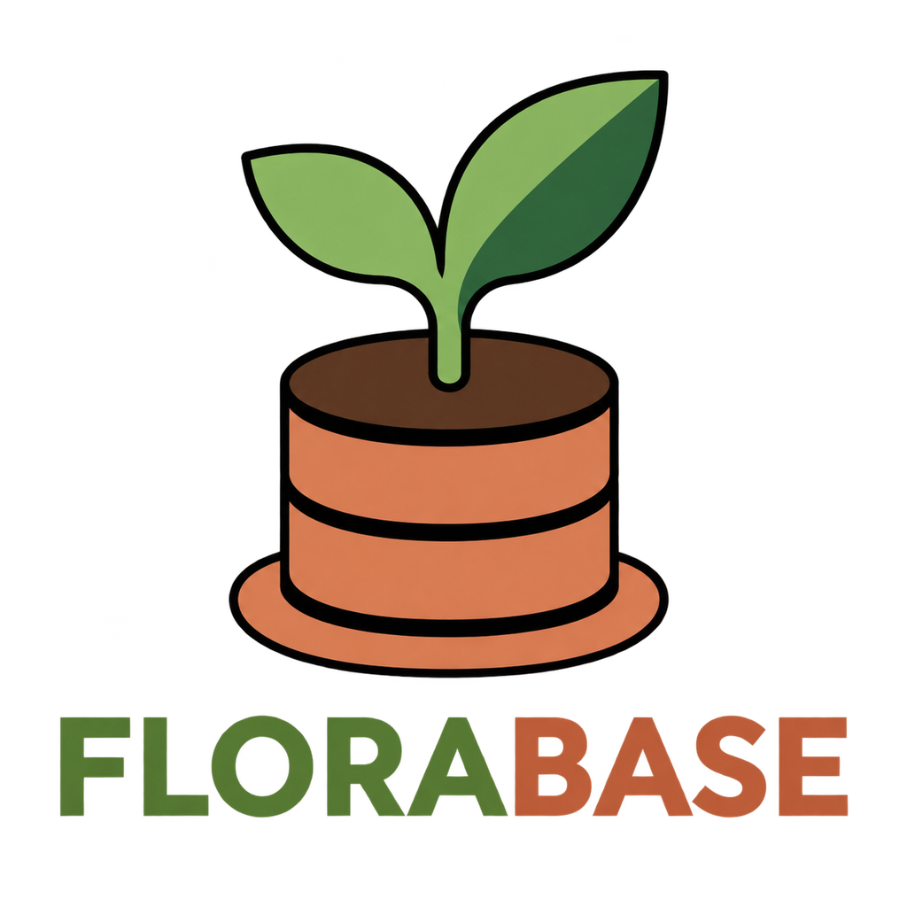
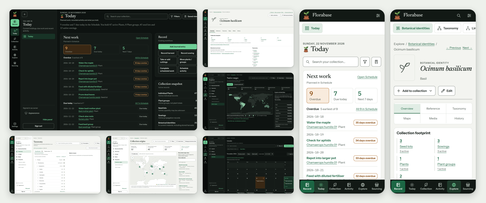

<p align="center">
  
</p>

<p align="center">
  
</p>

Florabase is a self-hosted web application for managing a personal botanical collection. It keeps
botanical reference information separate from the material and plants in a collection, while
preserving explicit provenance through real collection workflows.

Florabase is under active pre-release development. The current application is usable for one local
owner, but no stable public release has been published yet. The private beta series
(`v0.1.0-beta.N`) leads to release candidates (`v1.0.0-rc.N`) and then v1.0.0, the first
public stable release.
The [v1.0.0 release scope](docs/release/scope-v1.md) defines what that release contains, its
gates and its exclusions.

## What works today

- Botanical identities, incomplete-friendly operator-authored profiles, structured native ranges,
  and explicit links to external GBIF references
- Supplier, scoped hierarchical collection Location, GeographicPlace, and ProvenanceSite directories
- Seed lots with source, partial dates, quantity, storage, lifecycle, and optional producer lineage
- Sowings with partial dates, quantities, cultivation details, and simple germination totals
- Individually tracked Plants and quantity-aware PlantGroups
- Plant and PlantGroup Journal Events and read-only cross-domain operational History
- Operational Dashboard and concrete planned work in Schedule List and Month Calendar
- Global search, saved operator views, atomic bulk Location moves and purchase Orders
- Guided CSV import/export, dated germination observations and printable labels with authenticated QR lookup
- Collection-aware occurrence/native-range Maps, reviewed native-range enrichment and a classification Taxonomy tree
- Explicit lineage through `SeedLot → Sowing → Plant / PlantGroup`, PlantGroup extraction, and
  collection-produced seed lots, with receipt-proven reversal for supported authoritative operations
- A collection provenance map for coordinate-bearing ProvenanceSites
- [Shared media library](docs/media-library.md): reusable local/external images, per-record captions
  and order, explicit primary selection, protected thumbnails, retained unlinked assets and guarded deletion.
- Collection-photo galleries and optional BotanicalIdentity covers; layered contextual form help
- Local owner authentication with server-side sessions and CSRF protection
- Structured Harvests of material collected from a Plant or Plant group, with stored material and
  explicit conversion to new seed lots; see the [Harvest guide](docs/harvests.md)
- A material ancestry explorer, accepted-name correction with retained name history and synonyms,
  Plant height measurements and phenology observations in the Journal
- Cuttings (vegetative propagation); delivered and still being finished and certified for v1.0.0
- Installation as a web app ([PWA](docs/pwa.md)); installation on physical phones is not yet verified

Each increment's implementation and verification status is in the
[feature backlog](docs/features.json) and its
[reconciliation against the release scope](docs/release/feature-reconciliation-v1.md). Mobile quick
capture and the other themes after v1.0.0 are in the [product roadmap](docs/product-roadmap.md).

## Screenshots

The showcase above uses invented demonstration data (no real collection, provenance or locations):
Today, a botanical identity, native ranges, the WFO taxonomy, collection origins and the month
calendar on desktop, plus Today and an identity on a phone, in the light and dark appearances. A
curated public screenshot set remains a release gate.

## Architecture

Florabase is a modular monolith:

- React and strict TypeScript in the browser
- FastAPI and typed Python for the versioned `/api/v1` API
- PostgreSQL as the relational source of truth
- Alembic as the only schema migration path
- Docker Compose for development and self-hosting
- backend-owned OpenAPI with committed generated TypeScript declarations

The production-oriented Compose stack publishes only the frontend proxy on `127.0.0.1`.
PostgreSQL and the backend publish no ports (and can be isolated on a separate `internal: true`
network via the optional hardened override in [docs/security.md](docs/security.md#optional-container-hardening)).

## Requirements

Repository development requires Docker Engine with Docker Compose **2.24.4 or newer**, GNU Make,
Python 3 and `curl`. The development overlay uses Compose's `!override` tag. Host Node.js is optional.
[Docker Compose merge rules](https://docs.docker.com/reference/compose-file/merge/)

For self-hosting, [install Florabase](docs/installation.md) with `compose.yaml` from the latest
release tag (`https://github.com/alessandrorossato/florabase/blob/<latest-tag>/compose.yaml`;
`main` may be ahead of the published `:latest` images): create the data and backup folders with
their owners once, edit the host folder paths, database password and canonical origin in
`compose.yaml`, and deploy in a Compose manager such as Dockhand or with `docker compose up -d`.
No container runs as root; it initializes a new installation, backs up before every upgrade, and
supports the Compose 2.20 baseline. It requires an HTTPS reverse proxy (or Tailscale Serve) and
the exact public HTTPS origin.

[Building from a source checkout](docs/deployment.md) is for development only.

## Quick start for development

Run this in the primary checkout:

```bash
make setup
```

`make setup` copies `.env.example` to the ignored `.env` file and preserves an existing
configuration. Review the file and replace its example credentials before starting DEV.

```bash
make dev-up &&
make dev-upgrade &&
make dev-bootstrap-owner LOGIN=owner
```

- `make dev-up` builds and starts persistent DEV from the primary checkout. It preserves existing
  data and leaves schema migration to the next step.
- `make dev-upgrade` applies pending Alembic migrations to DEV and verifies that its database reaches
  the code's migration head.
- `make dev-bootstrap-owner LOGIN=owner` creates the initial DEV owner and prompts for the password
  without echoing it.

Open `http://localhost:5173` with the default development port.

## Development

`make check` runs formatting checks, lint, strict Python and TypeScript typing, backend and frontend
tests, and generated API drift checks. PostgreSQL integration tests run separately with
`make test-integration`. See [development.md](docs/development.md) for focused workflows, migrations,
code generation, and Git practices.

## Backup and restore

`make backup` stops backend writes while creating a paired custom-format PostgreSQL dump and local
attachment-volume archive. `make restore` deliberately replaces both and requires explicit
confirmation. Read [backup-restore.md](docs/backup-restore.md) before restoring; deployment
configuration and secrets still need a separate protected backup.

## Project information

- [v1.0.0 release scope](docs/release/scope-v1.md)
- [Installation, upgrade, backup and restore](docs/installation.md)
- [Source-build deployment and upgrades](docs/deployment.md) (development)
- [Development guide](docs/development.md)
- [Domain model](docs/domain-model.md)
- [Architecture](docs/architecture.md)
- [Security architecture](docs/security.md)
- [Contributing](CONTRIBUTING.md)
- [Security policy](SECURITY.md)
- [Changelog](CHANGELOG.md)
- [Versioning and compatibility](docs/versioning.md)
- [Product roadmap](docs/product-roadmap.md)
- [Engineering progress](docs/progress.md)

## License

Florabase is free and open-source software licensed under the
GNU Affero General Public License v3.0 or later.

SPDX-License-Identifier: AGPL-3.0-or-later

See [LICENSE](LICENSE) for the full license text.
