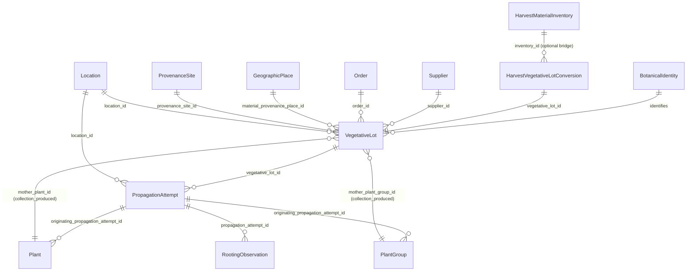

# Vegetative Propagation Domain Design — CUTTING-001

8 November 2026 · `feat/cutting-001-design` · domain architecture and data-model specification (pre-schema).

Status: **Design ready for architectural review** (`CUTTING-001` remains `planned` in `docs/features.json`; no production schema, migration, or runtime endpoint has been changed).

---

## 1. Purpose and Domain Boundary

Florabase models sexual propagation through `SeedLot → Sowing → Plant | PlantGroup`. Vegetative (asexual, clonal) propagation follows a fundamentally different biological and operational lifecycle:

$$\text{Mother Plant / PlantGroup (or External Source)} \longrightarrow \text{Vegetative Material} \longrightarrow \text{Propagation Attempt} \longrightarrow \text{Plant / PlantGroup}$$

### Why a Cutting Is Not a `SeedLot`

1. **Biological nature**: A `SeedLot` is a packet of dormant, sexually produced seeds (frequently holding genetic variation, cross-parentage in `CROSS-001`, and multi-year shelf storage measured in `count`, `weight:g`, or `volume:ml`). A cutting batch is living, perishable vegetative tissue (stem, leaf, or root section) that carries a clonal genotype of its mother plant and typically transitions immediately or after brief holding into rooting medium.
2. **Lifecycle and storage**: `SeedLot` inventory supports long-term storage, packet viability decay, and repeated partial sowings over years. Forcing cuttings into `SeedLot` would pollute Seed directory counts, Germination statistics (`GERMINATION-001`), Order seed-lot reconciliations (`ORDER-001`), and Harvest-to-SeedLot conversions (`HARVEST-003`).
3. **Provenance and parentage**: A `SeedLot` uses `producer_plant_id` / `producer_plant_group_id` for harvested seed parent stock. A vegetative cutting taken from a specimen in the collection is a direct somatic clone of that mother specimen (`mother_plant_id` / `mother_plant_group_id`).

### Why Rooting Is Not a `Sowing`

1. **Physiological process**: `Sowing` models seed dormancy breaking (scarification, cold stratification, soaking) and radicle emergence (`germinated_count`, `GerminationObservation`, first-germination lag, and $T_{50}$ metrics). Vegetative rooting models callusing, adventitious root initiation, hormone treatment (e.g., IBA/NAA), humidity dome/misting regimes, and strike/survival counts (`rooted_count`, `RootingObservation`).
2. **Analytical separation**: Mixing rooting attempts into `sowings` would corrupt species germination rates, $T_{50}$ curves, and Sowing directory filters (`SOWING-001`, `GERMINATION-001`, `DASHBOARD-001`).

### Explicit Non-Goals for `CUTTING-001`

- **No polymorphic base table** unifying `SeedLot` + `VegetativeLot` or `Sowing` + `PropagationAttempt`.
- **No premature implementation of all asexual methods**: `CUTTING-001` implements stem, leaf, and root cuttings first while ensuring the schema and lineage graph cleanly accommodate division, offsets/pups, layering, and grafting in subsequent increments without destructive migrations.
- **No dormancy-organ storage lifecycle**: Storage organ inventory (tubers, corms, bulbs, rhizomes, caudices) and seasonal dormancy cycles remain scoped to `TUBER-001`.

---

## 2. Architectural Alternatives and Decision Matrix

We evaluate three primary architectural approaches (including two sub-variants of Architecture 2):

### Architecture 1: `VegetativeLot` + `PropagationAttempt` (Two-Entity Material + Attempt Model)

Separates the **acquired or severed vegetative material batch** (`VegetativeLot`) from the **rooting execution** (`PropagationAttempt`):

- **`VegetativeLot`** (`vegetative_lots`): Represents a physical batch of unrooted cuttings or vegetative propagules either severed from an in-collection mother (`mother_plant_id` or `mother_plant_group_id` when `source_kind = 'collection_produced'`), converted from an existing `HarvestMaterialInventory` (`stem_or_shoot` / `leaf` / `root`), or acquired externally (`purchased`, `gift_exchange`, `self_collected`, `other`, `unknown`). Owns `botanical_identity_id`, `material_type` (`stem_cutting`, `leaf_cutting`, `root_cutting`), `taken_on` (`PartialDate`), starting quantity (`quantity_value`, `quantity_is_approximate`), current holding `location_id`, external acquisition (`supplier_id`, `order_id`), wild/direct provenance (`material_provenance_place_id`, `provenance_site_id`), and lifecycle (`active`, `exhausted`, `discarded`, `lost`, `reversed`).
- **`PropagationAttempt`** (`propagation_attempts`): Represents a concrete rooting setup drawing material from a `VegetativeLot` (`vegetative_lot_id`). Owns `attempt_kind` (initially `'cutting'`), `started_on` and `ended_on` (`PartialDate`), `quantity_started` (`value`, `is_approximate`), rooting treatment (`hormone_treatment`, `substrate`, `container`, `environment`, `temperature_min_c`, `temperature_max_c`), current rooting `location_id`, `rooted_count` (`INTEGER NULL`), dated `RootingObservation` child rows (`rooting_observations`), and `lifecycle` (`active`, `completed`, `failed`, `abandoned`, `reversed`).
- **Descendant linkage**: Resulting `Plant` and `PlantGroup` rows link via `originating_propagation_attempt_id` (mutually exclusive with `originating_sowing_id`, `originating_plant_group_id`, and direct-origin columns).
- **Ergonomic fast path**: Because gardeners taking cuttings from a mother plant frequently stick them directly into rooting medium on the same day, the service and UI expose an **atomic single-step creation endpoint** (`POST /api/v1/propagation-attempts/fast-create` or `"create_attempt_immediately": true` on lot creation) that creates both the `VegetativeLot` and its initial `PropagationAttempt` (plus the reversible `OperationReceipt`) in one transaction, while still allowing a `VegetativeLot` to be held in storage or split across multiple rooting attempts (e.g., testing perlite vs sphagnum moss on 10 cuttings from the same batch).

### Architecture 2: Generalized Typed `Propagation` with Explicit Source Material

This architecture appears in two distinct structural forms:

#### Variant 2A: Single-Entity Typed `VegetativePropagation` Aggregate (Source Material Embedded in the Attempt)

Combines material acquisition/taking and rooting attempt into a single table (`vegetative_propagations`):

- One row holds `propagation_method` (`stem_cutting`, `leaf_cutting`, `root_cutting`, and later `division`, `offset`, `layering`), discriminated source columns (`mother_plant_id`, `mother_plant_group_id`, `source_harvest_inventory_id`, or external `source_kind` + `supplier_id` + `provenance_site_id`), `taken_on` (`PartialDate`), `started_on` (`PartialDate`), `initial_quantity`, `rooted_count`, substrate/hormone/environment fields, and `lifecycle`.
- Resulting `Plant` / `PlantGroup` rows reference `originating_vegetative_propagation_id`.
- **Tradeoff**: Simpler when 100% of cuttings are struck immediately in one homogeneous setup, but **cannot represent**:
  1. Acquiring or severing a batch of 12 cuttings and splitting them across two rooting attempts (e.g., 6 in water, 6 in perlite, or striking 6 today and holding 6 in cold storage for a week) without duplicating acquisition/provenance metadata or fabricating fake parent-child attempt links.
  2. Holding unrooted cuttings in inventory (received in mail/exchange before sticking, or callusing succulent cuttings for 10 days before placing on substrate) before any rooting environment Exists.
  3. Tracking partial consumption and remaining unrooted material when an attempt is undone via `REVERSAL-001`.

#### Variant 2B: Polymorphic / Unified `PropagationMaterial` + `Propagation` Replacing or Subsuming `SeedLot` and `Sowing`

Generalizes `seed_lots` into `propagation_materials (kind = 'seed_lot' | 'vegetative_lot')` and `sowings` into `propagations (kind = 'sowing' | 'cutting' | ...)`.

- **Tradeoff**: Explicitly violates the `CUTTING-001` and `TUBER-001` roadmap constraint (*"without overloading SeedLot or Sowing... or introducing a polymorphic base table"*). Requires high-risk destructive migration of existing `seed_lots`, `sowings`, `germination_observations`, `operation_receipts`, `record_media_links`, `scheduled_activities`, and `harvest_seed_lot_conversions`, and weakens PostgreSQL `CHECK` constraints because seed-only fields (weight/volume units, scarification, stratification, $T_{50}$) and vegetative-only fields (cutting organ, rooting hormone, callus state) become sparsely nullable columns on the same table.

### Architecture 3: Alternative Supported by Existing Florabase Workflows (`Harvest` + `HarvestMaterialInventory` + Direct `Plant`/`PlantGroup`)

Uses already-delivered `HARVEST-001`, `HARVEST-002`, and `PLANT-001` tables without a new vegetative propagation domain:

- Record taking cuttings as a `Harvest` on the mother `Plant` or `PlantGroup` with `HarvestItem(material_kind = 'stem_or_shoot' | 'leaf' | 'root')`.
- Manage the unrooted cuttings in `HarvestMaterialInventory`.
- When cuttings root, record a `HarvestMaterialDisposition(kind = 'used_for_propagation')` and create a `Plant` or `PlantGroup` with `direct_origin_kind = 'collection_produced'`.
- **Why this fails domain requirements**:
  1. **Broken clonal lineage**: On `Plant` and `PlantGroup`, `direct_origin_kind = 'collection_produced'` has **no foreign key** to a mother `Plant`, `PlantGroup`, or `Harvest` (`producer_plant_id` exists only on `SeedLot`). The resulting `Plant` is a root node in `LINEAGE-001`/`LINEAGE-002` with no link to its mother plant.
  2. **Cannot represent unknown or external sources**: `Harvest` requires `num_nonnulls(plant_id, plant_group_id) = 1`. Unrooted cuttings purchased from a nursery, received in a trade, or wild-collected have no in-collection mother `Plant`/`PlantGroup` and therefore cannot enter `Harvest` or `HarvestMaterialInventory`.
  3. **No rooting attempt state or historical failure retention**: `HarvestMaterialDisposition(kind = 'used_for_propagation')` is a terminal stock deduction. It cannot represent an active/pending rooting attempt, substrate/hormone conditions, `started_on` vs `taken_on` `PartialDate`, partial rooting (`rooted_count` vs initial quantity), or a failed rooting attempt retained as first-class historical propagation evidence.

### Architectural Comparison Matrix

| Dimension | Arch 1: `VegetativeLot` + `PropagationAttempt` (Recommended) | Arch 2A: Single-Entity Typed `VegetativePropagation` | Arch 2B: Polymorphic Base Tables (`PropagationMaterial` + `Propagation`) | Arch 3: Existing `HarvestInventory` + Direct `Plant` |
| --- | --- | --- | --- | --- |
| **1. Migrations** | Additive: 3 new tables (`vegetative_lots`, `propagation_attempts`, `rooting_observations`) + narrow FK column additions on `plants`, `plant_groups`, `record_media_links`, `collection_primary_photos`, `scheduled_activities`, `locations`, and `operation_receipts`. Zero backfill on existing rows. | Additive: 2 new tables (`vegetative_propagations`, `rooting_observations`) + same narrow FK additions. Zero backfill. If multi-attempt batch splitting is needed later, requires data-migrating 1 table into 2. | High-risk invasive rewrite of `seed_lots` and `sowings` FKs across 12+ tables; breaks stable API contracts and existing `TEST-DATA-001` golden digests. | Zero or minimal migration, but fails core `CUTTING-001` acceptance criteria. |
| **2. Ownership & Source Semantics** | Clear separation: `VegetativeLot` owns material acquisition/taking (`collection_produced` mother vs `purchased` / `gift_exchange` / `self_collected` / `other` / `unknown`) and remaining unrooted stock; `PropagationAttempt` owns rooting execution, observations, and outcome. | Single record owns both source acquisition and rooting execution; breaks down when one acquired cutting batch is split across multiple rooting setups or held unrooted before sticking. | Confuses sexual packet ownership with clonal organ ownership; forces conditional invariants by `material_kind`. | `Harvest` owns only in-collection harvests; external/unknown cuttings have no home; `HarvestMaterialDisposition` owns only stock subtraction. |
| **3. Provenance (`ProvenanceSite`, `GeographicPlace`, `Supplier`, `Order`)** | Direct wild/geographic provenance and `Supplier`/`Order` live on `VegetativeLot` (only when externally sourced/wild-collected, paralleling `SeedLot`). In-collection cuttings (`collection_produced`) derive upstream provenance from the mother `Plant`/`PlantGroup` without duplicating markers on `MAP-001` Collection Origins. | Direct provenance lives on the attempt record; if a user splits a wild-collected cutting batch into 3 attempts, 3 rows carry direct `provenance_site_id`, falsely tripling `MAP-001` direct-origin counts. | Mixes seed and cutting provenance in one table; complicates `ORDER-001` seed-lot reconciliation. | `Harvest` has no `supplier_id`, `order_id`, or `provenance_site_id`. |
| **4. API Complexity** | Clean REST resources (`/api/v1/vegetative-lots`, `/api/v1/propagation-attempts`) plus an atomic fast-create payload so common "take cuttings & stick immediately" requires 1 request. | Slightly fewer endpoints initially (1 resource), but requires complex self-referential or split endpoints once batch splitting is needed. | High conditional validation complexity across every seed and sowing endpoint. | Requires awkward multi-call orchestration across `/harvests`, `/harvest-inventory`, and `/plants` with missing domain fields. |
| **5. Lineage & Cycle Protection** | First-class DAG path: `Plant / PlantGroup (mother) → VegetativeLot → PropagationAttempt → Plant / PlantGroup (offspring)`. Extends `_WALK` CTE and `florabase_lineage_has_cycle` trigger cleanly under `pg_advisory_xact_lock(1179406162, 1)`. | First-class path: `Plant / PlantGroup → VegetativePropagation → Plant / PlantGroup`. Cannot group sibling attempts from the same severed material batch under one material node. | Requires rewriting existing lineage CTE and trigger branches. | **Broken**: `direct_origin_kind = 'collection_produced'` on `Plant` has no mother FK; cycle detection and lineage graph cannot connect mother to offspring. |
| **6. Journal (`Event`)** | Preserves `Event` strictly for `Plant` and `PlantGroup` (`num_nonnulls(plant_id, plant_group_id) = 1`). Optionally records an operation-owned mother `Event` when taking cuttings from a living collection plant; no parallel Event table for cuttings. | Same clean `Event` boundary on mother and offspring `Plant`/`PlantGroup`. | Risks polluting `Event` targets if generalized carelessly. | `Harvest` creates a `harvest` Event on the mother, but no rooting or offspring transition is linked. |
| **7. Operational `History` (`HISTORY-001`)** | Adds read-only `UNION ALL` projection branches for `VegetativeLot` creation (when taken from mother or converted from harvest inventory), `PropagationAttempt` start, `RootingObservation`, and attempt-to-`Plant`/`PlantGroup` receipts, with backing-row deduplication. | Similar `UNION ALL` branches, minus the distinct material-to-attempt transition receipt. | Requires refactoring existing `sowings` and `seed_lots` history branches. | Projects only `Harvest` and `used_for_propagation` disposition; rooting start, observations, and failed attempts are invisible. |
| **8. `Schedule` (`SCHEDULE-001`)** | Adds `vegetative_lot_id` and `propagation_attempt_id` target columns to `scheduled_activities` (`num_nonnulls(...) <= 1`) and supports `check_rooting` (or existing `inspect` / `follow_up` / `pot_up` / `other`) on active records. | Adds `vegetative_propagation_id` to `scheduled_activities`; cannot schedule a reminder on unrooted held material before an attempt starts. | Breaks existing `seed_lot_id` / `sowing_id` target specificity. | Cannot schedule rooting inspections on a `HarvestMaterialDisposition`. |
| **9. Media (`RecordMediaLink`, `CollectionPrimaryPhoto`)** | Adds nullable `vegetative_lot_id` and `propagation_attempt_id` to `record_media_links` and `collection_primary_photos` (`num_nonnulls(...) = 1`). `RecordVisual` falls back from `PropagationAttempt` → `VegetativeLot` → mother `Plant`/`PlantGroup` → `BotanicalIdentity` cover. | Adds `vegetative_propagation_id` to media tables; photos of unrooted received cuttings vs rooted callused cuttings share one record bucket. | Requires migrating existing media link columns and composite FKs. | `Harvest` supports media, but rooting progress and failed attempts cannot own photos. |
| **10. Future Extensions (Division, Offsets, Layering, Grafting, `TUBER-001`)** | **High**: Division/offsets use the same model or atomic fast path; air layering uses `PropagationAttempt` (`attempt_kind = 'layering'`, `attached_to_mother = true`) before severance; grafting adds `rootstock_plant_id` / `rootstock_vegetative_lot_id` alongside scion `vegetative_lot_id`; `HarvestMaterialInventory` (`stem_or_shoot`) can convert into a `VegetativeLot` just like `HARVEST-003` converts seed into `SeedLot`. | Layering and grafting are awkward when source material is flattened into the attempt (grafting requires two distinct source materials: scion + rootstock). | Violates roadmap anti-polymorphism constraint. | Cannot support layering, grafting, or tracked rooting attempts. |

### Architectural Decision

**Select Architecture 1 (`VegetativeLot` + `PropagationAttempt` + `RootingObservation`), paired with an atomic single-step fast-entry workflow for immediate cuttings and an optional `HarvestMaterialInventory` bridge.**

Why this combination wins:
1. **Honors the domain pipeline (`Mother Plant → Vegetative material → Propagation attempt → Plant / PlantGroup`)**: It preserves the exact conceptual parity with `SeedLot → Sowing → Plant / PlantGroup` without overloading either table or introducing a polymorphic base table.
2. **Zero friction for the 80% immediate-sticking case**: When an operator takes cuttings from a mother plant and places them directly into rooting medium, a single guided action creates the `VegetativeLot` (`exhausted` if all cuttings are struck immediately, or `active` if some remain held) and the `PropagationAttempt` atomically in one database transaction.
3. **Full fidelity for the 20% multi-stage or external cases**: When an operator receives unrooted cuttings in the mail, calluses succulent cuttings before potting, or splits 10 cuttings from one mother pruning across two different rooting substrates/hormone treatments, `VegetativeLot` represents the shared material batch accurately without duplicating wild provenance or supplier links.

---

## 3. Recommended Minimal Data Model

All tables follow ADR 0004 (application-generated `uuid7()` primary keys, UTC `DateTime(timezone=True)` timestamps) and Florabase's single-owner installation model (no per-user `owner_id` column).



### 3.1 `VegetativeLot` (`vegetative_lots`)

Represents a distinct physical batch of vegetative propagation material (in `CUTTING-001`, stem, leaf, or root cuttings).

| Column | Type | Null | Default / Constraint | Purpose |
| --- | --- | --- | --- | --- |
| `id` | `UUID` | `NOT NULL` | `uuid7()` PK | Stable identifier (ADR 0004) |
| `botanical_identity_id` | `UUID` | `NOT NULL` | `FK -> botanical_identities.id ON DELETE RESTRICT` | Required taxon/cultivar identity; defaults to mother's identity when taken from collection, independently correctable |
| `label` | `VARCHAR(255)` | `NULL` | `ck_vegetative_lots_label` (single-line, trimmed) | Optional human label for directory/lineage/history display |
| `material_type` | `VARCHAR(32)` | `NOT NULL` | `IN ('stem_cutting', 'leaf_cutting', 'root_cutting')` | Vegetative organ kind (`CUTTING-001` scope) |
| `source_kind` | `VARCHAR(32)` | `NOT NULL` | `IN ('collection_produced', 'purchased', 'gift_exchange', 'self_collected', 'other', 'unknown')` | How the cutting batch entered or was produced in the collection |
| `source_detail` | `VARCHAR(255)` | `NULL` | `ck_vegetative_lots_source_detail` (allowed only when `source_kind = 'other'`) | Free-text detail when `source_kind = 'other'` |
| `mother_plant_id` | `UUID` | `NULL` | `FK -> plants.id ON DELETE RESTRICT` | Known mother `Plant` (allowed only when `source_kind = 'collection_produced'`) |
| `mother_plant_group_id` | `UUID` | `NULL` | `FK -> plant_groups.id ON DELETE RESTRICT` | Known mother `PlantGroup` (allowed only when `source_kind = 'collection_produced'`) |
| `supplier_id` | `UUID` | `NULL` | `FK -> suppliers.id ON DELETE RESTRICT` | External source party (allowed only when `source_kind != 'collection_produced'`) |
| `order_id` | `UUID` | `NULL` | `FK -> orders.id ON DELETE RESTRICT` | Purchase order link (allowed only when `source_kind = 'purchased'`) |
| `material_provenance_place_id` | `UUID` | `NULL` | `FK -> geographic_places.id ON DELETE RESTRICT` | Direct geographic origin place (allowed only when `source_kind != 'collection_produced'`) |
| `provenance_site_id` | `UUID` | `NULL` | `FK -> provenance_sites.id ON DELETE RESTRICT` | Direct collection site (allowed only when `source_kind != 'collection_produced'`) |
| `location_id` | `UUID` | `NULL` | `FK -> locations.id ON DELETE RESTRICT` | Current holding Location (must have `supports_vegetative_lots = true` on new assignment) |
| `taken_on_precision` | `VARCHAR(8)` | `NULL` | `PartialDate` (`'year'`, `'month'`, `'day'`) | Precision of the severing / collection / acquisition date (`String(8)`) |
| `taken_on_year` | `SMALLINT` | `NULL` | `1..9999` | Year cuttings were taken or acquired (`SmallInteger()`) |
| `taken_on_month` | `SMALLINT` | `NULL` | `1..12` | Month cuttings were taken or acquired (`SmallInteger()`) |
| `taken_on_day` | `SMALLINT` | `NULL` | `1..31` | Day cuttings were taken or acquired (`SmallInteger()`) |
| `initial_quantity_value` | `INTEGER` | `NULL` | `> 0` when non-null | Starting cutting count when taken/acquired (`NULL` = unknown starting quantity) |
| `initial_quantity_is_approximate` | `BOOLEAN` | `NULL` | Non-null iff `initial_quantity_value IS NOT NULL` | Whether starting cutting count is exact (`false`) or approximate (`true`) |
| `quantity_value` | `INTEGER` | `NULL` | `> 0`, or `0` only when `lifecycle = 'exhausted' AND quantity_is_approximate = false` | Current remaining unrooted cutting count (`NULL` = unknown) |
| `quantity_is_approximate` | `BOOLEAN` | `NULL` | Non-null iff `quantity_value IS NOT NULL` | Whether current remaining count is exact or approximate |
| `lifecycle` | `VARCHAR(32)` | `NOT NULL` | `IN ('active', 'exhausted', 'discarded', 'lost', 'reversed')` | Current lot lifecycle state |
| `notes` | `TEXT` | `NULL` | `ck_vegetative_lots_notes` (trimmed, 1..20,000 chars, no control chars except `\n`, `\t`) | Operator notes (e.g., node count, wood maturity: softwood/semi-hardwood/hardwood) |
| `created_at` | `TIMESTAMPTZ` | `NOT NULL` | `utc_now()` | Record creation timestamp |
| `updated_at` | `TIMESTAMPTZ` | `NOT NULL` | `utc_now()` | Optimistic concurrency token |

#### Key `VegetativeLot` Database Constraints

- `ck_vegetative_lots_label`: single-line trimmed non-empty `label` (`char_length(label) BETWEEN 1 AND 255 AND label = btrim(label) AND label !~ '[[:cntrl:]]'`).
- `ck_vegetative_lots_material_type`: `material_type IN ('stem_cutting', 'leaf_cutting', 'root_cutting')`
- `ck_vegetative_lots_source_kind`: `source_kind IN ('collection_produced', 'purchased', 'gift_exchange', 'self_collected', 'other', 'unknown')`
- `ck_vegetative_lots_source_detail`: `(source_detail IS NULL) OR (source_kind = 'other' AND char_length(source_detail) BETWEEN 1 AND 255 AND source_detail = btrim(source_detail) AND source_detail !~ '[[:cntrl:]]')`
- `ck_vegetative_lots_mother_exclusive`: `NOT (mother_plant_id IS NOT NULL AND mother_plant_group_id IS NOT NULL)`
- `ck_vegetative_lots_mother_source_kind`: `source_kind = 'collection_produced' OR (mother_plant_id IS NULL AND mother_plant_group_id IS NULL)`
- `ck_vegetative_lots_external_provenance_not_collection_produced`: `source_kind != 'collection_produced' OR (supplier_id IS NULL AND order_id IS NULL AND material_provenance_place_id IS NULL AND provenance_site_id IS NULL)`
- `ck_vegetative_lots_order_source`: `order_id IS NULL OR source_kind = 'purchased'`
- `ck_vegetative_lots_taken_on_partial_date`: standard Florabase `PartialDate` check (`make_date(taken_on_year, taken_on_month, taken_on_day)` validity).
- `ck_vegetative_lots_initial_quantity`: `(initial_quantity_value IS NULL AND initial_quantity_is_approximate IS NULL) OR (initial_quantity_value IS NOT NULL AND initial_quantity_is_approximate IS NOT NULL AND initial_quantity_value > 0)`
- `ck_vegetative_lots_current_quantity`: `(quantity_value IS NULL AND quantity_is_approximate IS NULL) OR (quantity_value IS NOT NULL AND quantity_is_approximate IS NOT NULL AND (quantity_value > 0 OR (quantity_value = 0 AND lifecycle = 'exhausted' AND quantity_is_approximate = false)))`
- `ck_vegetative_lots_lifecycle`: `lifecycle IN ('active', 'exhausted', 'discarded', 'lost', 'reversed')`
- `ck_vegetative_lots_notes`: `notes IS NULL OR (char_length(notes) BETWEEN 1 AND 20000 AND notes = btrim(notes) AND regexp_replace(notes, E'[\\n\\t]', '', 'g') !~ '[[:cntrl:]]')`

---

### 3.2 `PropagationAttempt` (`propagation_attempts`)

Represents one concrete vegetative propagation attempt (striking/rooting a batch or subset of cuttings under specific conditions).

| Column | Type | Null | Default / Constraint | Purpose |
| --- | --- | --- | --- | --- |
| `id` | `UUID` | `NOT NULL` | `uuid7()` PK | Stable identifier (ADR 0004) |
| `vegetative_lot_id` | `UUID` | `NOT NULL` | `FK -> vegetative_lots.id ON DELETE RESTRICT` | Source vegetative material batch |
| `label` | `VARCHAR(255)` | `NULL` | `ck_propagation_attempts_label` (single-line, trimmed) | Optional human label for directory/lineage/history display |
| `attempt_kind` | `VARCHAR(32)` | `NOT NULL` | `IN ('cutting')` (extensible) | Propagation method category (`'cutting'` in `CUTTING-001`) |
| `location_id` | `UUID` | `NULL` | `FK -> locations.id ON DELETE RESTRICT` | Rooting Location (e.g., mist bench, propagation propagator box; `supports_propagation_attempts = true`) |
| `started_on_precision` | `VARCHAR(8)` | `NULL` | `PartialDate` (`'year'`, `'month'`, `'day'`) | Precision of start/sticking date (`String(8)`) |
| `started_on_year` | `SMALLINT` | `NULL` | `1..9999` | Start year (`SmallInteger()`) |
| `started_on_month` | `SMALLINT` | `NULL` | `1..12` | Start month (`SmallInteger()`) |
| `started_on_day` | `SMALLINT` | `NULL` | `1..31` | Start day (`SmallInteger()`) |
| `ended_on_precision` | `VARCHAR(8)` | `NULL` | `PartialDate` (`'year'`, `'month'`, `'day'`) | Precision of completion/failure/abandonment date (`String(8)`) |
| `ended_on_year` | `SMALLINT` | `NULL` | `1..9999` | End year (`SmallInteger()`) |
| `ended_on_month` | `SMALLINT` | `NULL` | `1..12` | End month (`SmallInteger()`) |
| `ended_on_day` | `SMALLINT` | `NULL` | `1..31` | End day (`SmallInteger()`) |
| `quantity_value` | `INTEGER` | `NULL` | `> 0` when non-null | Number of cuttings placed into this attempt (`NULL` = unknown starting quantity) |
| `quantity_is_approximate` | `BOOLEAN` | `NULL` | Non-null iff `quantity_value IS NOT NULL` | Whether starting quantity is exact (`false`) or approximate (`true`) |
| `rooted_count` | `INTEGER` | `NULL` | `>= 0` when non-null | Number of cuttings that formed viable roots / survived (`NULL` = pending or unrecorded) |
| `hormone_treatment` | `VARCHAR(500)` | `NULL` | `_single_line_constraint("hormone_treatment", 500)` | Rooting hormone/auxin treatment (e.g., `"IBA 0.3% gel"`, `"Willow water"`, `"None"`) |
| `substrate` | `VARCHAR(500)` | `NULL` | `_single_line_constraint("substrate", 500)` | Rooting medium (e.g., `"Perlite + peat 1:1"`, `"Live sphagnum"`, `"Water"`) |
| `container` | `VARCHAR(500)` | `NULL` | `_single_line_constraint("container", 500)` | Vessel/setup (e.g., `"7 cm square pot"`, `"Plug tray 24-cell"`, `"Propagation dome"`) |
| `environment` | `VARCHAR(500)` | `NULL` | `_single_line_constraint("environment", 500)` | Environmental regime (e.g., `"Heated mat 24°C, 85% RH, 14h LED"`) |
| `temperature_min_c` | `NUMERIC(5,2)` | `NULL` | `-50.00 .. 70.00` | Minimum target rooting temperature (°C) |
| `temperature_max_c` | `NUMERIC(5,2)` | `NULL` | `>= temperature_min_c` | Maximum target rooting temperature (°C) |
| `lifecycle` | `VARCHAR(32)` | `NOT NULL` | `IN ('active', 'completed', 'failed', 'abandoned', 'reversed')` | Rooting attempt lifecycle |
| `notes` | `TEXT` | `NULL` | `ck_propagation_attempts_notes` (trimmed, 1..20,000 chars, no control chars except `\n`, `\t`) | General attempt notes |
| `created_at` | `TIMESTAMPTZ` | `NOT NULL` | `utc_now()` | Record creation timestamp |
| `updated_at` | `TIMESTAMPTZ` | `NOT NULL` | `utc_now()` | Optimistic concurrency token |

#### Key `PropagationAttempt` Database Constraints

- `ck_propagation_attempts_label`, `ck_propagation_attempts_hormone_treatment`, `ck_propagation_attempts_substrate`, `ck_propagation_attempts_container`, `ck_propagation_attempts_environment`, and `ck_propagation_attempts_notes`: standard Florabase single-line and multiline text constraints matching `sowings/model.py`.
- `ck_propagation_attempts_attempt_kind`: `attempt_kind IN ('cutting')`
- `ck_propagation_attempts_lifecycle`: `lifecycle IN ('active', 'completed', 'failed', 'abandoned', 'reversed')`
- `ck_propagation_attempts_started_on_partial_date` & `ck_propagation_attempts_ended_on_partial_date`: standard `PartialDate` checks.
- `ck_propagation_attempts_date_order`: comparable `PartialDate` range check ensuring `ended_on >= started_on` whenever shared precision components are present (matching `ck_sowings_date_order`).
- `ck_propagation_attempts_quantity`: `(quantity_value IS NULL AND quantity_is_approximate IS NULL) OR (quantity_value IS NOT NULL AND quantity_is_approximate IS NOT NULL AND quantity_value > 0)`
- `ck_propagation_attempts_rooted_count`: `rooted_count IS NULL OR rooted_count >= 0`
- `ck_propagation_attempts_rooted_count_within_exact_count`: `NOT (quantity_is_approximate = false AND quantity_value IS NOT NULL AND rooted_count IS NOT NULL) OR rooted_count <= quantity_value`

---

### 3.3 `RootingObservation` (`rooting_observations`)

Parallels `GerminationObservation` on `Sowing`, recording dated progress checks during rooting (callus visible, first roots visible, cumulative rooted count, rot/loss notes) without fabricating `Plant` journal `Event`s before a `Plant` exists.

| Column | Type | Null | Default / Constraint | Purpose |
| --- | --- | --- | --- | --- |
| `id` | `UUID` | `NOT NULL` | `uuid7()` PK | Stable identifier |
| `propagation_attempt_id` | `UUID` | `NOT NULL` | `FK -> propagation_attempts.id ON DELETE CASCADE` | Owning propagation attempt |
| `observed_on_precision` | `VARCHAR(8)` | `NULL` | `PartialDate` (`'year'`, `'month'`, `'day'`) | Observation date precision (`String(8)`) |
| `observed_on_year` | `SMALLINT` | `NULL` | `1..9999` | Observation year (`SmallInteger()`) |
| `observed_on_month` | `SMALLINT` | `NULL` | `1..12` | Observation month (`SmallInteger()`) |
| `observed_on_day` | `SMALLINT` | `NULL` | `1..31` | Observation day (`SmallInteger()`) |
| `stage` | `VARCHAR(32)` | `NOT NULL` | `IN ('callus', 'root_initials', 'rooted', 'loss', 'inspection')` | Observed biological stage |
| `rooted_count` | `INTEGER` | `NULL` | `>= 0` when non-null | Observed cumulative rooted count at this date (`NULL` if qualitative inspection only) |
| `notes` | `TEXT` | `NULL` | `ck_rooting_observations_notes` (trimmed, 1..20,000 chars) | Observation notes |
| `created_at` | `TIMESTAMPTZ` | `NOT NULL` | `utc_now()` | Creation timestamp |
| `updated_at` | `TIMESTAMPTZ` | `NOT NULL` | `utc_now()` | Update timestamp |

---

### 3.4 Descendant Linkage on `Plant` and `PlantGroup` (`ck_plants_origin` and `ck_plant_groups_origin`)

In `backend/src/florabase/plants/model.py`, origin exclusivity and required origin presence are enforced by a single combined check constraint on each table (`ck_plants_origin` and `ck_plant_groups_origin`):

- **`plants`**: Add nullable `originating_propagation_attempt_id UUID REFERENCES propagation_attempts(id) ON DELETE RESTRICT` (indexed) and replace `ck_plants_origin`:
  ```sql
  (
    num_nonnulls(
      originating_plant_group_id,
      originating_sowing_id,
      originating_propagation_attempt_id
    ) = 1
    AND direct_origin_kind IS NULL
    AND direct_origin_detail IS NULL
    AND supplier_id IS NULL
    AND material_provenance_place_id IS NULL
    AND provenance_site_id IS NULL
  ) OR (
    originating_plant_group_id IS NULL
    AND originating_sowing_id IS NULL
    AND originating_propagation_attempt_id IS NULL
    AND direct_origin_kind IN ('purchased', 'gift_exchange', 'collection_produced', 'other', 'unknown')
  )
  ```
- **`plant_groups`**: Add nullable `originating_propagation_attempt_id UUID REFERENCES propagation_attempts(id) ON DELETE RESTRICT` (indexed) and replace `ck_plant_groups_origin`:
  ```sql
  (
    num_nonnulls(
      originating_sowing_id,
      originating_propagation_attempt_id
    ) = 1
    AND direct_origin_kind IS NULL
    AND direct_origin_detail IS NULL
    AND supplier_id IS NULL
    AND material_provenance_place_id IS NULL
    AND provenance_site_id IS NULL
  ) OR (
    originating_sowing_id IS NULL
    AND originating_propagation_attempt_id IS NULL
    AND direct_origin_kind IN ('purchased', 'gift_exchange', 'collection_produced', 'other', 'unknown')
  )
  ```

---

## 4. Required Domain Cases Walkthrough

### Case 1: Known Mother `Plant` (or `PlantGroup`) vs Unknown / External Source

- **Known mother `Plant` in collection**:
  - `VegetativeLot.source_kind = 'collection_produced'`, `mother_plant_id = <plant_uuid>`, `mother_plant_group_id = NULL`.
  - `botanical_identity_id` defaults to `mother_plant.botanical_identity_id` (while remaining independently correctable if a sport/chimaera or misidentification is later discovered).
  - Direct acquisition/provenance fields (`supplier_id`, `order_id`, `material_provenance_place_id`, `provenance_site_id`) are `NULL` (enforced by `ck_vegetative_lots_external_provenance_not_collection_produced`); upstream provenance is derived by walking the lineage graph back to the mother `Plant`'s origin.
- **Known mother `PlantGroup` in collection**:
  - `VegetativeLot.source_kind = 'collection_produced'`, `mother_plant_group_id = <group_uuid>`, `mother_plant_id = NULL`.
- **Unknown source**:
  - `VegetativeLot.source_kind = 'unknown'`, `mother_plant_id = NULL`, `mother_plant_group_id = NULL`.
  - `botanical_identity_id` is explicitly selected by the operator (even if it is an indet. genus-level `BotanicalIdentity` such as *Hoya* sp.).
- **Purchased / Gift-Exchange / Wild Self-Collected unrooted cuttings**:
  - `source_kind` is `'purchased'`, `'gift_exchange'`, `'self_collected'`, or `'other'`; `mother_plant_id` and `mother_plant_group_id` are `NULL`.
  - May carry explicit `supplier_id`, `order_id` (when `'purchased'`), `material_provenance_place_id`, and `provenance_site_id` (which then surface in `MAP-001` / `MAPS-ORIGINS-001` as direct collection origins).

### Case 2: Single (`1`) and Multiple (`> 1`) Cuttings

- **Single cutting**: `VegetativeLot` has `initial_quantity_value = 1, initial_quantity_is_approximate = false`. When struck in a `PropagationAttempt`, `PropagationAttempt.quantity_value = 1, quantity_is_approximate = false`. When rooted, it transitions directly into a single individual `Plant` (`originating_propagation_attempt_id`).
- **Multiple cuttings**: `VegetativeLot` has `initial_quantity_value = N` ($N > 1$), exact or approximate. It can be struck in one `PropagationAttempt` ($N$ cuttings) or split across several `PropagationAttempt`s ($n_1 + n_2 \le N$). When rooted, the attempt can transition into either:
  - A `PlantGroup` (e.g., 8 rooted *Lavandula* cuttings potted together into a nursery flat, `quantity_value = 8`), from which individual `Plant`s can later be extracted via `PLANT-002` / `PLANT-006`; or
  - Multiple individual `Plant` records created through repeated partial transitions or one batch transition.

### Case 3: `PartialDate` Taken and Start Dates

- Both `VegetativeLot.taken_on` and `PropagationAttempt.started_on` / `ended_on` use Florabase's 4-column `PartialDate` representation (`_precision`, `_year`, `_month`, `_day`):
  - Exact day: `precision = 'day', year = 2026, month = 5, day = 14`.
  - Month only: `precision = 'month', year = 2026, month = 5, day = NULL`.
  - Year only: `precision = 'year', year = 2026, month = NULL, day = NULL`.
  - Unknown date: all 4 columns `NULL`.
- When using the fast-create workflow ("Take & stick cuttings"), `PropagationAttempt.started_on` defaults to `VegetativeLot.taken_on` at its exact precision without fabricating missing month or day components, and can be overridden independently.

### Case 4: Unknown Starting Quantity

- When a gardener takes an uncounted handful of creeping stems or receives an uncounted bundle of unrooted cuttings:
  - `VegetativeLot.initial_quantity_value = NULL`, `initial_quantity_is_approximate = NULL`, `quantity_value = NULL`, `quantity_is_approximate = NULL`.
  - `PropagationAttempt.quantity_value = NULL`, `quantity_is_approximate = NULL`.
- Transitions from a `VegetativeLot` with unknown quantity never fabricate a numeric remainder: the operator explicitly chooses whether the source `VegetativeLot` remains `active` (`partial` use) or becomes `exhausted` (`all` use), identical to `PROPAGATION-001` for `SeedLot → Sowing`.

### Case 5: Pending, Successful, Failed, and Partial Rooting Outcomes

| Outcome State | `PropagationAttempt.lifecycle` | `PropagationAttempt.rooted_count` | Descendant `Plant` / `PlantGroup` | Meaning |
| --- | --- | --- | --- | --- |
| **Pending (In progress)** | `'active'` | `NULL` (or intermediate `>= 0` during staged observations) | None yet (or partial early potting while rest remain active) | Cuttings are on the bench; final outcome is not yet determined |
| **Full Success** | `'completed'` | `= quantity_value` (when exact count known) or `> 0` / `NULL` | 1 or more `Plant` / `PlantGroup` records | All cuttings rooted and were potted up / established (or attempt concluded successfully) |
| **Partial Rooting** | `'active'` (while remaining cuttings continue) or `'completed'` (once attempt finishes) | `0 < rooted_count < quantity_value` | Created for the rooted survivors (`<= rooted_count`) | e.g., 4 of 10 cuttings rooted and became `Plant`s; 6 rotted |
| **Failed Attempt** | `'failed'` | `0` (confirmed zero rooted) or `NULL` (failed before counting) | None (`0` descendants) | All cuttings rotted/desiccated; attempt ended with no surviving plants |
| **Abandoned** | `'abandoned'` | `NULL` or `>= 0` | Optional prior partial descendants | Operator terminated the attempt for non-biological reasons (space, pest discard) |

### Case 6: Initial Quantity vs Rooted / Surviving Quantity (Truthful Denominators)

- `quantity_value` (starting cuttings placed in the attempt) and `rooted_count` (cuttings that formed viable roots) are separate columns with independent nullability.
- **Never equate unknown rooting with failure**:
  - `rooted_count IS NULL` means **"not recorded / pending"**, never `0`.
  - `rooted_count = 0` means **"explicitly observed zero rooted cuttings"**.
  - Crucially, a `PropagationAttempt` may even reach `lifecycle = 'completed'` and produce a `Plant` while `rooted_count IS NULL` (if the operator potted up a surviving cutting without recording a formal rooting count), or have `lifecycle = 'active'` with `rooted_count = 0` (Checked at week 1: 0 rooted so far, still waiting).
- **Rooting percentage calculation rule** (matching `GERMINATION-001` / `COLLECTION-VISUAL-001`):
  - A rooting percentage ($\text{rooted\_count} / \text{quantity\_value} \times 100\%$) is computed and displayed **only** when `quantity_value IS NOT NULL AND quantity_is_approximate = false AND quantity_value > 0 AND rooted_count IS NOT NULL`.
  - When `quantity_is_approximate = true`, the UI displays `"3 rooted of ~10 cuttings"` without a fabricated percentage.
  - When `quantity_value IS NULL`, the UI displays `"3 rooted (starting count unknown)"`.

### Case 7: Rooted Offspring Linked to Known Mother (Clonal Lineage)

- When a `Plant` or `PlantGroup` is created from a `PropagationAttempt` (`originating_propagation_attempt_id`), its lineage chain is:
  $$\text{Mother } \mathtt{Plant} \xrightarrow{\text{mother\_plant\_id}} \mathtt{VegetativeLot} \xrightarrow{\text{vegetative\_lot\_id}} \mathtt{PropagationAttempt} \xrightarrow{\text{originating\_propagation\_attempt\_id}} \text{Offspring } \mathtt{Plant / PlantGroup}$$
- In `GET /api/v1/plants/{id}/lineage` (and `GET /api/v1/propagation-attempts/{id}/lineage`, `GET /api/v1/vegetative-lots/{id}/lineage`), the recursive walk returns the `PropagationAttempt`, the `VegetativeLot`, the mother `Plant` (or `PlantGroup`), and all of the mother's upstream ancestors (`Sowing`, `SeedLot`, grandparent `Plant`s).
- On the offspring `Plant` Details Overview, a **Clonal mother** summary badge links directly to the mother `Plant`/`PlantGroup` beside the `PropagationAttempt` link, and on the mother `Plant` Details page, a **Vegetative offspring & cuttings** section lists both active/historical `VegetativeLot`s taken from it and the resulting rooted `Plant`/`PlantGroup` clones.

### Case 8: Failed Attempts Retained as Historical Evidence

- A failed `PropagationAttempt` (`lifecycle = 'failed'`, `ended_on = PartialDate`, optional `rooted_count = 0`, optional `RootingObservation`s and photos of rot/callus failure) is **retained permanently**.
- Deletion of a `PropagationAttempt` or `VegetativeLot` is restricted (`ON DELETE RESTRICT`) whenever dependent attempts, observations, receipts, or offspring exist; normal workflow uses `lifecycle = 'failed'` or `'abandoned'` (or `'discarded'` / `'lost'` on `VegetativeLot`).
- **Representation scope rules (`EXPLORE-001`, `TAXONOMY-003`, `DASHBOARD-001`)**:
  - **Living**: Living `Plant` / `PlantGroup` only (`active` `VegetativeLot` and `PropagationAttempt` are not counted as established living plants, matching `SeedLot` and `Sowing`).
  - **Current**: Includes `active` `VegetativeLot`s and `active` `PropagationAttempt`s alongside living `Plant`/`PlantGroup` and active `SeedLot`/`Sowing`.
  - **Historical**: Includes `failed`, `abandoned`, and `completed` `PropagationAttempt`s and `exhausted`, `discarded`, and `lost` `VegetativeLot`s (excluding `'reversed'` records, matching `REVERSAL-001` / `HARVEST-003`).
  - Thus, if a collector receives cuttings of a new species, fails to root them (`lifecycle = 'failed'`), and has no other records of that species, the `BotanicalIdentity` is truthfully classified as **Historical** in Explore and Taxonomy rather than disappearing or falsely appearing as **Living**.

### Case 9: Future Extension Cases (Evaluated, Not Prematurely Implemented)

How the recommended model extends to other vegetative propagation methods in later increments without breaking `CUTTING-001`:

1. **Division (`division`) and Offsets / Pups / Suckers (`offset`)**:
   - Often a division or rooted pup is separated from a mother `Plant` or `PlantGroup` with roots already present and potted immediately as a new `Plant`, or placed briefly in a recovery/rooting tray.
   - *Extension path*: Add `'division'` and `'offset'` to `VegetativeLot.material_type` and `PropagationAttempt.attempt_kind`. When a division already has roots at separation, the atomic fast-complete transition creates the `VegetativeLot` (`material_type = 'division'`), a completed `PropagationAttempt` (`attempt_kind = 'division'`), and the resulting `Plant` in one step—preserving a uniform lineage graph (`Mother Plant → VegetativeLot → PropagationAttempt → Clonal Offspring Plant`) without adding a separate `mother_plant_id` self-FK on `plants`.
2. **Layering and Air Layering (`layering`)**:
   - In ground layering or air layering (marcottage), rooting happens **while the stem is still attached to the living mother `Plant`**, and severance occurs only *after* roots have formed in the moss ball.
   - *Extension path*: Add `'layering'` to `PropagationAttempt.attempt_kind` and `'air_layer'` / `'ground_layer'` to `VegetativeLot.material_type`, with a boolean `attached_to_mother BOOLEAN NOT NULL DEFAULT false` on `PropagationAttempt`. While `lifecycle = 'active'`, `attached_to_mother = true` indicates the layer is still physically on the mother plant; `VegetativeLot.taken_on` records the severance date when the rooted layer is cut from the mother and potted into a `Plant`.
3. **Grafting and Budding (`grafting`)**:
   - Grafting combines **two** distinct genetic parents into one physical specimen: a **scion** (upper shoot providing the crown/cultivar identity) and a **rootstock** (lower rooted plant or unrooted cutting providing the root system and vigor/hardiness).
   - *Extension path*: In a future `GRAFT-001` increment, `PropagationAttempt` (`attempt_kind = 'grafting'`) uses `vegetative_lot_id` for the **scion** material batch and adds two nullable columns on `propagation_attempts`:
     - `rootstock_plant_id UUID NULL REFERENCES plants(id) ON DELETE RESTRICT` (when grafting onto an established rootstock `Plant`), or
     - `rootstock_vegetative_lot_id UUID NULL REFERENCES vegetative_lots(id) ON DELETE RESTRICT` (when bench-grafting/stenting onto an unrooted rootstock cutting),
     with `num_nonnulls(rootstock_plant_id, rootstock_vegetative_lot_id) <= 1`.
   - The lineage graph (`LINEAGE-002`) then walks **both** `vegetative_lot_id` (labeled `scion_parent`) and `rootstock_plant_id` / `rootstock_vegetative_lot_id` (labeled `rootstock_parent`), just as `CROSS-001` walks seed parent and pollen parent for controlled crosses! Nothing in `CUTTING-001` needs to be rewritten when `GRAFT-001` arrives.

---

## 5. Cross-Capability Integration Contracts

### 5.1 Lineage Integrity and Database Cycle Detection (`LINEAGE-002`)

Because a `VegetativeLot` can reference `mother_plant_id` or `mother_plant_group_id` (`source_kind = 'collection_produced'`), and its `PropagationAttempt` produces a descendant `Plant` or `PlantGroup` (`originating_propagation_attempt_id`), assigning a descendant `Plant` as the `mother_plant_id` of its own upstream `VegetativeLot` would create a directed cycle in the collection lineage graph:

$$\mathtt{Plant}_A \longrightarrow \mathtt{VegetativeLot}_1 \longrightarrow \mathtt{PropagationAttempt}_1 \longrightarrow \mathtt{Plant}_B \xrightarrow{\text{invalid edit}} \mathtt{VegetativeLot}_0 \longrightarrow \dots \longrightarrow \mathtt{Plant}_A$$

To preserve `docs/lineage-integrity.md` and `backend/alembic/versions/20261002_0030_lineage_integrity.py` invariants:
1. **Serialization lock**: All writes that set or modify `vegetative_lots.mother_plant_id`, `vegetative_lots.mother_plant_group_id`, `propagation_attempts.vegetative_lot_id`, `plants.originating_propagation_attempt_id`, or `plant_groups.originating_propagation_attempt_id` MUST call `lock_lineage_writes(session)` (`SELECT pg_advisory_xact_lock(1179406162, 1)`).
2. **Recursive CTE & Two-Trigger Architecture**:
   - Extend `florabase_lineage_has_cycle(subject_kind, subject_id)` in PostgreSQL and `_WALK` in `backend/src/florabase/lineage/service.py` with the four vegetative edge types:
     - `vegetative_lot -> mother_plant` (`relationship = 'produced_by_plant'`)
     - `vegetative_lot -> mother_plant_group` (`relationship = 'produced_by_plant_group'`)
     - `propagation_attempt -> vegetative_lot` (`relationship = 'struck_from_vegetative_lot'`)
     - `plant -> propagation_attempt` and `plant_group -> propagation_attempt` (`relationship = 'rooted_from_attempt'`)
   - Attach the standard two-trigger lineage pair to `vegetative_lots` and `propagation_attempts`, and include `originating_propagation_attempt_id` in the existing trigger column lists on `plants` and `plant_groups`:
     - `trg_{table}_lineage_lock`: `BEFORE INSERT OR UPDATE OF {columns} ON {table} FOR EACH STATEMENT EXECUTE FUNCTION florabase_lock_lineage_writes()`
     - `trg_{table}_lineage_check`: `AFTER INSERT OR UPDATE OF {columns} ON {table} FOR EACH ROW EXECUTE FUNCTION florabase_check_lineage('{kind}')` (must be `AFTER ... FOR EACH ROW` so the persisted row is visible to `florabase_lineage_has_cycle()`).
   - Following `lineage/service.py`, `GET /api/v1/vegetative-lots/{id}/lineage` and `GET /api/v1/propagation-attempts/{id}/lineage` return `LineageResponse(subject, ancestors)` (upstream ancestry walk), while downstream attempts and descendants are exposed via `GET /api/v1/vegetative-lots/{id}` and `GET /api/v1/propagation-attempts/{id}/propagation-summary` (matching `SowingPropagationSummary` in `propagation/service.py`).

### 5.2 Guided Transitions and Reversible Operation Receipts (`PROPAGATION-001/002/003`, `REVERSAL-001`)

Cuttings support three explicit, transactional propagation transitions backed by `OperationReceipt` (`backend/src/florabase/reversals/model.py`):

1. **`vegetative_lot_to_propagation_attempt`**:
   - Locks `VegetativeLot` (`FOR UPDATE`). Verifies `VegetativeLot.lifecycle == 'active'`.
   - Applies the exact quantity transition algebra established by `seed_lot_to_sowing` (`PROPAGATION-001`):
     - `adjustment_mode = 'none'`: leaves the `VegetativeLot` quantity and `active` lifecycle untouched.
     - `adjustment_mode = 'partial'`: keeps `VegetativeLot.lifecycle = 'active'` unless an exact subtraction reaches zero; for an exact source quantity, requires an exact child attempt quantity $k \le N$, subtracts $N - k$ authoritatively on the locked row, rejects oversubscription (`409`), and marks the lot `exhausted` (`quantity_value = 0`) if the remainder is `0`; for an approximate source quantity, requires an explicit operator-confirmed resulting approximate quantity (`resulting_quantity`) rather than silent arithmetic; for an unknown source quantity, leaves quantity `NULL` (`active`).
     - `adjustment_mode = 'use_all'`: marks any active `VegetativeLot` `exhausted`; an exact source quantity becomes exact `0` (`quantity_value = 0, quantity_is_approximate = false`), while an approximate or unknown source quantity keeps its honest approximate or `NULL` representation without inventing an exact `0`.
   - Persists an `OperationReceipt` with `kind = 'vegetative_lot_to_propagation_attempt'`, `vegetative_lot_id`, `propagation_attempt_id`, `adjustment_mode`, `before_lifecycle` / `after_lifecycle`, `before_quantity_*` / `after_quantity_*` (`quantity_kind = 'count'`, `unit = NULL` when non-null), and `result_snapshot_version = 1` (`result_lifecycle`, `result_quantity_*`, `result_botanical_identity_id`, `result_location_id`, `result_date_*` from `started_on`, `source_location_id`).
2. **`propagation_attempt_to_plant`** and **`propagation_attempt_to_plant_group`**:
   - Locks `PropagationAttempt` (`FOR UPDATE`) and its `VegetativeLot`. Verifies `PropagationAttempt.lifecycle == 'active'`.
   - Creates the `Plant` (quantity `1`) or `PlantGroup` (`quantity_value >= 1` or `NULL`) with `originating_propagation_attempt_id = attempt.id` and `botanical_identity_id = vegetative_lot.botanical_identity_id`.
   - Applies the explicit operator-selected resulting `PropagationAttempt.lifecycle` (`'active'`, `'completed'`, `'failed'`, or `'abandoned'`; creating a descendant never completes an attempt automatically, and there is no partially-completed lifecycle state).
   - `rooted_count` remains an independent operator-entered current observation (neither rewritten automatically nor required to equal materialized descendants, matching `Sowing.germinated_count` in `PROPAGATION-001`).
   - Propagation transitions do not automatically create `Event` rows (`PlantGroup` extraction remains the narrow exception).
   - Persists an `OperationReceipt` with `kind = 'propagation_attempt_to_plant'` or `'propagation_attempt_to_plant_group'`, `propagation_attempt_id`, `plant_id` / `plant_group_id`, `source_vegetative_lot_id` (paralleling `source_seed_lot_id`), `before_lifecycle` / `after_lifecycle`, `before_quantity_*` / `after_quantity_*` (`quantity_kind = 'count'`), and `result_snapshot_version = 1`.
3. **Undo Eligibility and Execution (`REVERSAL-001` / `PROPAGATION-003` / `propagation/reversal.py`)**:
   - Following `backend/src/florabase/propagation/reversal.py`, any post-operation change to the result or source record's lifecycle, quantity, botanical identity, location, or date (`started_on` / `collection_entry_date`) **hard-blocks** automatic reversal (`status = "blocked"` with `result_lifecycle_changed`, `result_structural_state_changed`, `source_lifecycle_changed`, `source_quantity_changed`, or `source_structural_state_changed`); structural drift is never overridden by confirmation.
   - Undoing `vegetative_lot_to_propagation_attempt` is hard-blocked (`status = "blocked"`) if the `PropagationAttempt` has any non-reversed descendant `Plant`/`PlantGroup`, media links, or scheduled activities. If the attempt has recorded `RootingObservation`s and no blocking drift, reversal returns `status = "confirmation_required"` (`reason = "retained_observations_exist"`) and requires `confirm_retained_observations = true`. Undo sets `PropagationAttempt.lifecycle = 'reversed'`, marks `OperationReceipt.status = 'reversed'`, and restores `VegetativeLot` `lifecycle` and `quantity_*` from `before_lifecycle` / `before_quantity_*`.
   - Undoing `propagation_attempt_to_plant` / `propagation_attempt_to_plant_group` is hard-blocked if the created `Plant`/`PlantGroup` has downstream lineage (extractions, transfers, produced `SeedLot`s, produced `VegetativeLot`s via `mother_plant_id` / `mother_plant_group_id`, or `Harvest`s), media links, or events. Additionally, existing `Sowing → Plant / PlantGroup` reversal in `propagation/reversal.py` must also check `VegetativeLot.mother_plant_id` / `mother_plant_group_id` (`produced_vegetative_lot_exists`).
4. **Optional `HarvestMaterialInventory` to `VegetativeLot` Bridge (`HARVEST-002/003` pattern)**:
   - When bridging managed `HarvestMaterialInventory` (`harvest_material_inventory.state = 'active'` with `HarvestItem.material_kind IN ('stem_or_shoot', 'leaf', 'root')`) into a `VegetativeLot`, follow the exact `HARVEST-003` `HarvestSeedLotConversion` pattern (`backend/src/florabase/harvests/conversion_model.py`) via a dedicated `harvest_vegetative_lot_conversions` table (`inventory_id`, `disposition_id UNIQUE`, `vegetative_lot_id UNIQUE`, `status IN ('applied', 'reversed')`, `source_correction_version`, `quantity_*`, `created_at`, `reversed_at`). This preserves `source_correction_version` lock checks and `reversed_at` history projection without adding ad-hoc harvest columns to `vegetative_lots`.

### 5.3 Journal (`Event`) vs Operational `History` (`HISTORY-001`)

- **Journal (`Event`) boundary**:
  - `Event` remains strictly scoped to `Plant` and `PlantGroup` (`ck_events_single_target: num_nonnulls(plant_id, plant_group_id) = 1`).
  - Following `PROPAGATION-001`, forward propagation transitions (`VegetativeLot → PropagationAttempt` and `PropagationAttempt → Plant / PlantGroup`) do **not** automatically manufacture `Event` rows on the mother or offspring specimen. Ordinary Journal `Event`s (`pruning`, `potting`, `observation`, etc.) remain explicit notebook entries on `Plant` or `PlantGroup`.
  - `RootingObservation`s on a `PropagationAttempt` are **not** `Event` rows (matching `GerminationObservation` on `Sowing`).
- **Operational `History` (`HISTORY-001`)**:
  - `backend/src/florabase/history/service.py` adds read-only `UNION ALL` branches over:
    1. `operation_receipts` for `vegetative_lot_to_propagation_attempt`, `propagation_attempt_to_plant`, and `propagation_attempt_to_plant_group` (projected at `Receipt.created_at` with `status = Receipt.status`, matching existing propagation receipts in `history/service.py`).
    2. `rooting_observations` (projecting dated rooting checks under category `'propagation'`, matching `germination_observations`).
    3. `harvest_vegetative_lot_conversions` (when the `HARVEST-002` bridge is enabled, collapsing the conversion-owned `used_for_propagation` disposition into one user-visible operation and projecting a distinct reversal row at `reversed_at`, matching `harvest_seed_lot_conversions`).
    4. `completions` (`ScheduledActivity`): outer-join `VegetativeLot` and `PropagationAttempt` (and `PropagationAttempt`'s `VegetativeLot`) and include `VegetativeLot.botanical_identity_id` in `func.coalesce(...)` so completed scheduled activities on cuttings resolve their taxon and deep links.

### 5.4 `Schedule` (`SCHEDULE-001`), `Location` (`LOCATION-001`), and `Media` (`ATTACHMENT-005`)

- **`Location`**:
  - Add boolean scope columns on `locations`:
    - `supports_vegetative_lots BOOLEAN NOT NULL DEFAULT false`
    - `supports_propagation_attempts BOOLEAN NOT NULL DEFAULT false`
  - Extend `ck_locations_at_least_one_scope` so a `Location` must support at least one of the 6 collection scopes.
  - Extend `locations/service.py` batched occupancy CTE to count active and total `VegetativeLot`s and `PropagationAttempt`s per Location.
- **`Schedule` (`backend/src/florabase/schedule/model.py`)**:
  - Add nullable `vegetative_lot_id` and `propagation_attempt_id` FKs on `scheduled_activities`, updating `ck_schedule_target`:
    ```sql
    num_nonnulls(
      botanical_identity_id,
      seed_lot_id,
      sowing_id,
      plant_id,
      plant_group_id,
      location_id,
      vegetative_lot_id,
      propagation_attempt_id
    ) <= 1
    ```
  - Add `'check_rooting'` to `ScheduledActivity.KINDS` (`("repot", "water", "fertilize", "move", "check_germination", "check_rooting", "inspect", "harvest", "follow_up")`) enforced by `ck_schedule_kind`.
  - Active `VegetativeLot` (`lifecycle = 'active'`) and active `PropagationAttempt` (`lifecycle = 'active'`) are eligible for new scheduled activities; terminal states (`exhausted`, `discarded`, `lost`, `completed`, `failed`, `abandoned`, `reversed`) refuse new scheduled work (`409`) while retaining historical scheduled rows.
- **`Media` (`backend/src/florabase/collection_photos/model.py`)**:
  - On `record_media_links`: add nullable `vegetative_lot_id` and `propagation_attempt_id` (`ON DELETE RESTRICT`), update `ck_record_media_links_single_target` (`num_nonnulls(...) = 1`), and add `uq_record_media_links_asset_vegetative_lot_id`, `uq_record_media_links_id_vegetative_lot_id`, `uq_record_media_links_asset_propagation_attempt_id`, and `uq_record_media_links_id_propagation_attempt_id`.
  - On `collection_primary_photos`: add nullable `vegetative_lot_id` and `propagation_attempt_id`, update `ck_collection_primary_photos_single_target` (`num_nonnulls(...) = 1`), add `uq_collection_primary_photos_vegetative_lot_id` and `uq_collection_primary_photos_propagation_attempt_id`, and add composite FKs `fk_primary_local_collection_photo_id_vegetative_lot_id`, `fk_primary_external_image_reference_id_vegetative_lot_id`, `fk_primary_local_collection_photo_id_propagation_attempt_id`, and `fk_primary_external_image_reference_id_propagation_attempt_id` referencing `record_media_links`.
  - Visual fallback in `collection_views/service.py`:
    - `VegetativeLot`: own primary photo → mother `Plant`/`PlantGroup` primary photo (if `collection_produced`) → `BotanicalIdentity` cover → none.
    - `PropagationAttempt`: own primary photo → `VegetativeLot` primary photo → mother `Plant`/`PlantGroup` primary photo → `BotanicalIdentity` cover → none.

---

## 6. Sample API Contracts

All endpoints live under `/api/v1`, require an authenticated session for reads, and require owner role + exact `Origin` + `X-CSRF-Token` for writes.

### 6.1 Endpoints Overview

| Method & Path | Purpose |
| --- | --- |
| `GET /api/v1/vegetative-lots` | Paginated directory of `VegetativeLot`s (`q`, `botanical_identity_id`, `mother_plant_id`, `mother_plant_group_id`, `material_type`, `source_kind`, `lifecycle`, `location_id`, `offset`, `limit`) |
| `POST /api/v1/vegetative-lots` | Create a standalone `VegetativeLot` |
| `GET /api/v1/vegetative-lots/{id}` | Retrieve `VegetativeLot` detail with mother summary, active/historical `PropagationAttempt`s, provenance, and visual |
| `PATCH /api/v1/vegetative-lots/{id}` | Partial update of `VegetativeLot` (validates invariants and lineage cycle check) |
| `DELETE /api/v1/vegetative-lots/{id}` | Delete only when unreferenced (`204`); otherwise `409 Conflict` |
| `GET /api/v1/vegetative-lots/{id}/lineage` | Upstream `LineageResponse(subject, ancestors)` for the `VegetativeLot` |
| `GET /api/v1/propagation-attempts` | Paginated directory of `PropagationAttempt`s (`q`, `botanical_identity_id`, `vegetative_lot_id`, `mother_plant_id`, `lifecycle`, `location_id`, `offset`, `limit`) |
| `POST /api/v1/propagation-attempts/fast-create` | **Atomic fast-entry**: create `VegetativeLot` + initial `PropagationAttempt` (+ `OperationReceipt`) in one transaction |
| `POST /api/v1/vegetative-lots/{id}/propagation-attempts` | Guided transition: start a `PropagationAttempt` from an existing active `VegetativeLot` (`vegetative_lot_to_propagation_attempt` receipt) |
| `GET /api/v1/propagation-attempts/{id}` | Retrieve `PropagationAttempt` detail with `VegetativeLot`, mother summary, `RootingObservation`s, and resulting `Plant`/`PlantGroup`s |
| `GET /api/v1/propagation-attempts/{id}/propagation-summary` | Protected descendant summary (`attempt_id`, `lifecycle`, `rooted_count`, `plants`, `plant_groups`, `exact_descendant_count`, `approximate_plant_group_count`, `unknown_plant_group_count`) |
| `PATCH /api/v1/propagation-attempts/{id}` | Update rooting conditions, `rooted_count`, `lifecycle` (`active`, `completed`, `failed`, `abandoned`), `ended_on`, or `notes` |
| `POST /api/v1/propagation-attempts/{id}/observations` | Record a dated `RootingObservation` (optionally updating `PropagationAttempt.rooted_count`) |
| `PATCH /api/v1/propagation-attempts/{id}/observations/{obs_id}` | Correct a `RootingObservation` |
| `DELETE /api/v1/propagation-attempts/{id}/observations/{obs_id}` | Delete a `RootingObservation` (`204`) |
| `POST /api/v1/propagation-attempts/{id}/plants` | Guided transition: establish an individual `Plant` from a rooting attempt (`propagation_attempt_to_plant` receipt) |
| `POST /api/v1/propagation-attempts/{id}/plant-groups` | Guided transition: establish a `PlantGroup` from a rooting attempt (`propagation_attempt_to_plant_group` receipt) |
| `GET /api/v1/propagation-attempts/{id}/lineage` | Upstream `LineageResponse(subject, ancestors)` for the `PropagationAttempt` |

### 6.2 Sample Request & Response Payloads

#### A. Atomic Fast-Create: Take Cuttings from a Mother `Plant` and Stick Immediately

`POST /api/v1/propagation-attempts/fast-create`

```json
{
  "vegetative_lot": {
    "botanical_identity_id": "0196ed40-1111-7000-8000-000000000001",
    "material_type": "stem_cutting",
    "source_kind": "collection_produced",
    "mother_plant_id": "0196ed40-2222-7000-8000-000000000002",
    "taken_on": {
      "precision": "day",
      "year": 2026,
      "month": 5,
      "day": 14
    },
    "initial_quantity": {
      "value": 6,
      "is_approximate": false
    },
    "notes": "Semi-hardwood apical cuttings, 2 nodes each"
  },
  "source_adjustment": {
    "mode": "use_all"
  },
  "propagation_attempt": {
    "started_on": {
      "precision": "day",
      "year": 2026,
      "month": 5,
      "day": 14
    },
    "quantity": {
      "value": 6,
      "is_approximate": false
    },
    "hormone_treatment": "IBA 0.3% rooting gel",
    "substrate": "Perlite + coco coir 1:1",
    "container": "6-cell propagation tray with humidity dome",
    "environment": "Indoor LED shelf, 22-25°C, 80% RH",
    "temperature_min_c": "22.00",
    "temperature_max_c": "25.00",
    "location_id": "0196ed40-3333-7000-8000-000000000003"
  }
}
```

`201 Created` Response:

```json
{
  "vegetative_lot": {
    "id": "0196ed45-aaaa-7000-8000-000000000010",
    "botanical_identity_id": "0196ed40-1111-7000-8000-000000000001",
    "material_type": "stem_cutting",
    "source_kind": "collection_produced",
    "mother_plant_id": "0196ed40-2222-7000-8000-000000000002",
    "mother_plant_group_id": null,
    "taken_on": { "precision": "day", "year": 2026, "month": 5, "day": 14 },
    "initial_quantity": { "value": 6, "is_approximate": false },
    "quantity": { "value": 0, "is_approximate": false },
    "lifecycle": "exhausted",
    "created_at": "2026-05-14T10:15:00Z",
    "updated_at": "2026-05-14T10:15:00Z"
  },
  "propagation_attempt": {
    "id": "0196ed45-bbbb-7000-8000-000000000011",
    "vegetative_lot_id": "0196ed45-aaaa-7000-8000-000000000010",
    "attempt_kind": "cutting",
    "started_on": { "precision": "day", "year": 2026, "month": 5, "day": 14 },
    "ended_on": null,
    "quantity": { "value": 6, "is_approximate": false },
    "rooted_count": null,
    "rooting_rate_percent": null,
    "hormone_treatment": "IBA 0.3% rooting gel",
    "substrate": "Perlite + coco coir 1:1",
    "container": "6-cell propagation tray with humidity dome",
    "environment": "Indoor LED shelf, 22-25°C, 80% RH",
    "temperature_min_c": "22.00",
    "temperature_max_c": "25.00",
    "location_id": "0196ed40-3333-7000-8000-000000000003",
    "lifecycle": "active",
    "created_at": "2026-05-14T10:15:00Z",
    "updated_at": "2026-05-14T10:15:00Z"
  },
  "operation_receipt_id": "0196ed45-cccc-7000-8000-000000000012"
}
```

#### B. Establish a Rooted Offspring `Plant` from an Active Attempt

`POST /api/v1/propagation-attempts/0196ed45-bbbb-7000-8000-000000000011/plants`

```json
{
  "resulting_attempt_lifecycle": "active",
  "plant": {
    "botanical_identity_id": "0196ed40-1111-7000-8000-000000000001",
    "label": "Clone #1 (apical)",
    "collection_entry_date": {
      "precision": "day",
      "year": 2026,
      "month": 6,
      "day": 18
    },
    "location_id": "0196ed40-4444-7000-8000-000000000004",
    "lifecycle": "active",
    "notes": "Strong root ball after 35 days; potted into 9 cm pot"
  }
}
```

#### C. Record a Failed Rooting Attempt (Retained as Historical Evidence)

`PATCH /api/v1/propagation-attempts/0196ed45-bbbb-7000-8000-000000000011`

```json
{
  "lifecycle": "failed",
  "rooted_count": 0,
  "ended_on": {
    "precision": "month",
    "year": 2026,
    "month": 6,
    "day": null
  },
  "notes": "Stem base blackened; damping off under high humidity"
}
```

---

## 7. Migration Safety Plan

When the implementation increment is authorized, the Alembic migration (`backend/alembic/versions/YYYYMMDD_NNNN_cutting_propagation.py`) must adhere to strict forward and downgrade safety rules:

1. **Zero Backfill on Existing Data**:
   - All existing `seed_lots`, `sowings`, `plants`, `plant_groups`, `harvests`, `locations`, `scheduled_activities`, `record_media_links`, and `operation_receipts` remain untouched.
   - New boolean scope columns on `locations` (`supports_vegetative_lots`, `supports_propagation_attempts`) default to `false` (`server_default=sa.text("false")`), so no existing `Location` is silently opted into holding cuttings.
2. **Additive Table Creation Order**:
   1. Create `vegetative_lots` with all `CHECK` constraints, FKs (`botanical_identities`, `plants`, `plant_groups`, `suppliers`, `orders`, `geographic_places`, `provenance_sites`, `locations`), and indexes.
   2. Create `propagation_attempts` with all `CHECK` constraints, FKs (`vegetative_lots`, `locations`), and indexes.
   3. Create `rooting_observations` with `ON DELETE CASCADE` to `propagation_attempts` and index on `(propagation_attempt_id, observed_on_year, observed_on_month, observed_on_day, id)`.
   4. (When `HARVEST-002` bridge is included) Create `harvest_vegetative_lot_conversions` referencing `harvest_material_inventory(id)`, `harvest_material_dispositions(id)`, and `vegetative_lots(id)`.
3. **Expanding Existing Tables Safely**:
   - **`plants` and `plant_groups`**: Add nullable `originating_propagation_attempt_id`, create index, and replace `ck_plants_origin` and `ck_plant_groups_origin`.
   - **`operation_receipts`**: Add nullable `vegetative_lot_id`, `propagation_attempt_id`, and `source_vegetative_lot_id` FKs (`ON DELETE RESTRICT`), and expand `ck_operation_receipts_kind`, `ck_operation_receipts_adjustment_mode`, `ck_operation_receipts_typed_references`, `ck_operation_receipts_before_quantity`, `ck_operation_receipts_after_quantity`, `ck_operation_receipts_typed_state`, and `ck_operation_receipts_result_snapshot` to include `'vegetative_lot_to_propagation_attempt'`, `'propagation_attempt_to_plant'`, and `'propagation_attempt_to_plant_group'`.
   - **`locations`**, **`scheduled_activities`** (`ck_schedule_target`, `ck_schedule_kind`), **`record_media_links`** (`ck_record_media_links_single_target` + unique constraints), **`collection_primary_photos`** (`ck_collection_primary_photos_single_target` + unique constraints + composite FKs), and **`saved_views`** (surface check constraint if a dedicated Cuttings directory Saved View surface is added): update constraints atomically.
4. **Lineage and Operation-Receipt Trigger Replacement Under Lock**:
   - Acquire `LOCK TABLE seed_lots, sowings, plants, plant_groups, vegetative_lots, propagation_attempts, operation_receipts IN SHARE ROW EXCLUSIVE MODE` before:
     - Replacing `florabase_lineage_has_cycle()`, updating `trg_plants_lineage_lock` / `trg_plants_lineage_check` and `trg_plant_groups_lineage_lock` / `trg_plant_groups_lineage_check` to include `originating_propagation_attempt_id`, and attaching `trg_vegetative_lots_lineage_lock` / `trg_vegetative_lots_lineage_check` and `trg_propagation_attempts_lineage_lock` / `trg_propagation_attempts_lineage_check`.
     - Replacing `florabase_check_new_operation_relationships()` (`trg_operation_receipt_relationships` on `operation_receipts`) to validate the three new cutting operation kinds.
5. **Populated-Downgrade Refusal Guards**:
   - In `downgrade()`, acquire `LOCK TABLE vegetative_lots, propagation_attempts, rooting_observations, plants, plant_groups, operation_receipts, scheduled_activities, record_media_links, collection_primary_photos, locations IN ACCESS EXCLUSIVE MODE`.
   - Before dropping any constraint or table, check whether any row exists in `vegetative_lots`, `propagation_attempts`, or `rooting_observations`, or whether any row in `plants`, `plant_groups`, `operation_receipts`, `scheduled_activities`, `record_media_links`, `collection_primary_photos`, or `locations` (`supports_vegetative_lots = true OR supports_propagation_attempts = true`) uses the new columns.
   - If any vegetative data exists, raise a descriptive PostgreSQL exception (`RAISE EXCEPTION 'Cannot downgrade CUTTING-001 migration while vegetative propagation records or scope flags exist'`) rather than silently truncating lineage or propagation history.
   - Verify clean `upgrade head → downgrade -1 → upgrade head` on an empty database via `make smoke-migration-cycle`.

---

## 8. UI Workflow Mockup Specification

All UI surfaces reuse [UI Foundation v0.1](ui-contract.md) tokens, `PageHeader`, `DirectoryTools`, `TaskDialog`, and the Collection visual grammar established in `GLOBAL-VISUAL-001` and `COLLECTION-VISUAL-001`.

### 8.1 Navigation and Entry Points

1. **Primary Navigation (`Collection` group)**:
   - Keep the frozen v0.1 sidebar compact: expose **Cuttings** (`#/cuttings`, or a unified **Propagation** workspace switch between **Sowings** and **Cuttings**) under **Collection**, plus contextual entry points on:
     - **Plant Details** & **PlantGroup Details** header action menu: **"Take cuttings"** (pre-fills `source_kind = 'collection_produced'`, `mother_plant_id` / `mother_plant_group_id`, and `botanical_identity_id`).
     - **Botanical Identity Hub** (`Overview` action menu): **"Add cuttings"** (pre-fills `botanical_identity_id`).
     - **Harvest Details** (`Stored material` section for `stem_or_shoot` / `leaf` / `root`): **"Create vegetative lot"**.
     - **Journal (`Activity → Journal`) Record menu**: **"Take cuttings"** routes directly to the canonical creation canvas.

### 8.2 Fast-Entry Creation Canvas ("Take or Add Cuttings")

 Full-page creation canvas (`#/cuttings/new?mother_plant_id=...`) with two clear sections and a default toggle **"Start rooting attempt immediately"** (checked by default when taking cuttings from a plant, unchecked when logging held/purchased unrooted material):

```text
+--------------------------------------------------------------------------------------------------+
| Collection / Cuttings                                                                            |
| Take or add cuttings                                                      [Cancel] [Save record] |
+--------------------------------------------------------------------------------------------------+
| 1. SOURCE & VEGETATIVE MATERIAL                                                                  |
|                                                                                                  |
| Botanical identity *   [ Monstera deliciosa 'Thai Constellation'                          (v) ]  |
| Material type *        (o) Stem cutting   ( ) Leaf cutting   ( ) Root cutting                    |
| Source *               [ Collection produced (from mother plant)                          (v) ]  |
| Mother specimen *      [ Plant: Thai Const. #1 (Living · Greenhouse Bench A)              (v) ]  |
|                                                                                                  |
| Taken / acquired on    Precision: [ Day (v) ]   Year [ 2026 ]  Month [ 05 ]  Day [ 14 ]          |
| Starting quantity      Mode: (o) Exact  ( ) Approximate  ( ) Unknown    Count: [ 4      ]        |
| Material notes         [ Top + 3 mid-stem single-node cuttings; aerial root primordia present ]  |
+--------------------------------------------------------------------------------------------------+
| 2. ROOTING SETUP                                                                                 |
| [x] Start rooting attempt immediately                                                            |
|                                                                                                  |
| Cuttings to strike     (o) All 4 cuttings (marks lot exhausted)   ( ) Partial subset             |
| Started on             [x] Same as taken date (2026-05-14)                                       |
| Rooting location       [ Propagation Box 2 (Greenhouse)                                   (v) ]  |
| Rooting medium         [ Damp sphagnum moss + perlite 70:30                                   ]  |
| Hormone / treatment    [ IBA 0.3% gel + callused 2 hours                                      ]  |
| Container              [ Clear 12 cm tall cup                                                 ]  |
| Environment            [ 24-27°C, 85% RH, 14h grow light                                      ]  |
| Target temp (°C)       Min [ 24.0 ]   Max [ 27.0 ]                                               |
+--------------------------------------------------------------------------------------------------+
```

- When **Source** is changed from `Collection produced` to `Purchased`, `Gift / exchange`, or `Self-collected`, the **Mother specimen** selector is replaced by the standard **Acquisition (Supplier / Purchase Order)** and **Origin (Geographic place / Provenance site)** controls.

### 8.3 Cuttings Directory & Non-Modal Quick Preview (`1440×844`, `1024×844`, `390×844`)

Reuses `PageHeader`, `DirectoryTools`, live filter drawer (`Lifecycle`, `Material type`, `Source kind`, `Location`, `Has known mother`), and Saved Views:

```text
+--------------------------------------------------------------------------------------------------+
| Collection                                                                                       |
| Cuttings                                                             [+ Take or add cuttings]    |
| [ Search species, mother plant, substrate... ] [ Filters (2) ] [ Saved views (v) ] [ List | Grid]|
+---------------------------------------------------------------+----------------------------------+
| ACTIVE ROOTING ATTEMPTS (3)                                   | QUICK PREVIEW                    |
|---------------------------------------------------------------| Monstera deliciosa               |
| [img] Monstera deliciosa 'Thai Constellation'    [Active]     | 'Thai Constellation'             |
|       Stem cutting · Mother: Thai Const. #1 · Started 14 May  | [Active rooting · 3 of 4 rooted] |
|       3 of 4 rooted (75%) · Sphagnum + perlite · Prop Box 2   |                                  |
|---------------------------------------------------------------| Source: Mother Plant             |
| [img] Hoya carnosa                               [Active]     |   -> Thai Const. #1              |
|       Stem cutting · Gift/exchange · Started May 2026         | Taken: 14 May 2026 (4 exact)     |
|       Rooting pending (approx. ~6 cuttings) · Water           | Medium: Sphagnum + perlite       |
|---------------------------------------------------------------| Hormone: IBA 0.3% gel            |
| HISTORICAL & FAILED (2)                                       | Location: Propagation Box 2      |
|---------------------------------------------------------------|                                  |
| [img] Ficus carica 'Brown Turkey'                [Failed]     | [Log rooting check]              |
|       Stem cutting · Mother: Orchard Fig #2 · 2025            | [Establish Plant / Group]        |
|       0 of 5 rooted (0%) · Retained historical attempt        | [Open details]          [Edit]   |
+---------------------------------------------------------------+----------------------------------+
```

### 8.4 Propagation Attempt Details & Guided "Establish Plant / PlantGroup" Dialog

On the `PropagationAttempt` Details page (`#/cuttings/attempts/{id}`):
- **Overview card**: Shows BotanicalIdentity link, Clonal Mother `Plant`/`PlantGroup` badge (or external source + Provenance link), `VegetativeLot` badge, `started_on` / `ended_on` `PartialDate`, Starting quantity vs `rooted_count` (showing percentage only when exact positive starting count and non-null `rooted_count`), substrate, hormone, container, environment, temperature range, and current `Location`.
- **Rooting observations timeline**: Chronological list of `RootingObservation` entries (`callus`, `root_initials`, `rooted`, `loss`, `inspection`) with **"Add observation"** modal.
- **Established offspring section**: Lists every `Plant` and `PlantGroup` created from this attempt with lifecycle badges and **"Undo establishment"** (`PROPAGATION-003`) where eligible.
- **Guided Transition Modal (`Establish Plant or PlantGroup`)**:
  - Invoked from **"Establish Plant / Group"** primary action button on an `active` `PropagationAttempt`.
  - Lets the operator choose:
    - **Target type**: `Individual Plant (quantity 1)` or `Plant group (batch)`.
    - **Update rooted count**: Current `rooted_count` input (optional; e.g., `3` of `4`).
    - **Attempt state after creation**:
      - `(o) Keep attempt active (more cuttings remain in rooting medium)`
      - `( ) Mark attempt completed (all viable cuttings are now potted)`
    - **New Plant / PlantGroup fields**: Label, `acquired_on` (`PartialDate`, defaulting to today), target `Location` (`supports_plants = true`), notes.
- **Responsive & Accessibility Contract**:
  - Desktop (`1440×844`): Master-detail directory + right Quick Preview inspector; full-width Details with two-column Overview + Lineage/Observations.
  - Tablet (`1024×844`): Wrapping `PageHeader` tools with no flex-basis collision; slide-over filter drawer; stacked Details sections.
  - Mobile (`390×844`): Single-column card rows, touch targets $\ge 44\text{ px}$, full-viewport `TaskDialog` modals with Cancel-first safe focus for destructive/terminal confirmations, focus containment, and focus restoration on close.

---

## 9. Acceptance Test Plan

When `CUTTING-001` implementation proceeds, verification must cover the following test matrices before marking the feature `verified`:

### 9.1 Unit Tests (`backend/tests/unit/`)

- **Quantity & Rooting Rate Invariants**:
  - `initial_quantity` and `quantity` validation (`exact`, `approximate`, `unknown`; `0` allowed only when `VegetativeLot.lifecycle == 'exhausted' AND quantity_is_approximate == false`).
  - `rooted_count` validation: `NULL` (pending/unknown) vs `0` (zero rooted) vs `> 0`; rejects `rooted_count > quantity_value` when `quantity_is_approximate == false`; permits `rooted_count > quantity_value` when `quantity_is_approximate == true` or `quantity_value IS NULL`.
  - Rooting rate percentage computed only when `quantity_is_approximate == false` and `quantity_value > 0` and `rooted_count IS NOT NULL`.
- **PartialDate & Range Validation**:
  - `taken_on`, `started_on`, `ended_on`, and `observed_on` accept `'year'`, `'month'`, `'day'`, and `NULL` precisions; reject invalid calendar dates (e.g., `2026-02-30`) and `ended_on < started_on` at shared precision.
- **Source & Provenance Exclusivity**:
  - `source_kind == 'collection_produced'` allows `mother_plant_id` or `mother_plant_group_id` (at most one) and rejects `supplier_id`, `order_id`, `material_provenance_place_id`, and `provenance_site_id`.
  - External `source_kind` rejects `mother_plant_id` and `mother_plant_group_id`, and allows `source_detail` only when `source_kind == 'other'`.

### 9.2 PostgreSQL Integration & Concurrency Tests (`backend/tests/integration/`)

- **Database Constraint Enforcement**:
  - Verify every `CHECK` constraint and `FOREIGN KEY ... ON DELETE RESTRICT` on `vegetative_lots`, `propagation_attempts`, `rooting_observations`, `plants`, `plant_groups`, `operation_receipts`, `locations`, `scheduled_activities`, `record_media_links`, and `collection_primary_photos`.
- **Clonal Lineage & Cycle Detection (`test_lineage_integrity.py`)**:
  - Verify `Mother Plant → VegetativeLot → PropagationAttempt → Offspring Plant` upstream ancestry traversal via `/lineage` and downstream descendant summaries via `/propagation-summary`.
  - Verify that attempting to set `VegetativeLot.mother_plant_id = offspring_plant.id` (directly or across multiple sexual + vegetative generations) is rejected by `florabase_lineage_has_cycle` (`trg_vegetative_lots_lineage_check`) and application service with `409 Conflict`.
  - Verify concurrent lineage writes contend on `pg_advisory_xact_lock(1179406162, 1)` (`trg_vegetative_lots_lineage_lock`) so two parallel transactions cannot close a cycle.
- **Atomic Transitions & Reversals (`test_cutting_propagation.py`)**:
  - Fast-create atomically creates `VegetativeLot` + `PropagationAttempt` + `OperationReceipt`.
  - Guided `PropagationAttempt → Plant` and `PropagationAttempt → PlantGroup` transitions lock rows, apply the selected `resulting_attempt_lifecycle`, and support `REVERSAL-001` undo restoring exact, approximate, and unknown before-states while blocking on structural drift or downstream dependencies (`produced_vegetative_lot_exists`).
- **Failed Attempt Historical Retention & Explore Scopes**:
  - Verify a `failed` `PropagationAttempt` (`rooted_count = 0` or `NULL`) is retained, surfaces in `History`, is excluded from `Living` and `Current` Explore/Taxonomy scopes, and is included in `Historical` scope.
- **Cross-Capability Regressions**:
  - `MAP-001`: In-collection cuttings (`collection_produced`) do not inflate direct-origin marker counts; wild-collected external `VegetativeLot`s with `provenance_site_id` appear in Collection Origins.
  - `HISTORY-001`: Verify `UNION ALL` pagination, timeline-year filtering, and deduplication of harvest-to-vegetative-lot dispositions and transition receipts.
  - `SCHEDULE-001` & `ATTACHMENT-005`: Verify scheduling `check_rooting` on active attempts, `409` on failed/completed attempts, and primary photo + `RecordVisual` fallback.
- **Migration Cycle & Downgrade Guard (`smoke-migration-cycle`)**:
  - Empty DB `upgrade head → downgrade -1 → upgrade head` succeeds.
  - Populated DB with a `VegetativeLot` or `PropagationAttempt` refuses `downgrade -1` cleanly without data loss.

### 9.3 Frontend Tests (`frontend/src/`)

- Fast-entry "Take or add cuttings" form: mother pre-fill, source-kind switching, `PartialDate` inputs, unknown/approximate/exact quantity modes, and validation error announcements.
- Attempt Details: rendering pending (`rooted_count = null`) vs zero (`0`) vs partial rooting without conflating unknown and zero; "Establish Plant / PlantGroup" modal; Undo confirmation flow.
- Responsive layout (`1440×844`, `1024×844`, `390×844`) and keyboard/screen-reader accessibility checks.

---

## 10. Bounded Implementation-Ready Next Step

To keep commits small, reviewable, and aligned with `AGENTS.md` (*"Work on one concrete backlog increment per feature branch; do not pre-build later capabilities"*), `CUTTING-001` should be implemented after operator approval of this design in two bounded waves (or one cohesive full-stack increment if preferred by the operator):

1. **Step 1 — Authoritative Schema, Lineage, and Propagation API (`CUTTING-001` backend core)**:
   - Add the single reviewed Alembic migration creating `vegetative_lots`, `propagation_attempts`, and `rooting_observations`, expanding `plants`, `plant_groups`, `operation_receipts`, `locations`, `scheduled_activities`, and media link constraints, and updating `florabase_lineage_has_cycle()`.
   - Implement `vegetative_lots` and `propagation_attempts` models, schemas, services, fast-create, `PropagationAttempt → Plant / PlantGroup` transitions, `REVERSAL-001` undo, `LINEAGE-002` traversal, `HISTORY-001` projections, and `EXPLORE-001` scope queries.
   - Regenerate OpenAPI and TypeScript declarations (`make api-generate`) and pass unit + PostgreSQL integration + migration cycle checks.
2. **Step 2 — Cuttings Workspace and Contextual Mother-Plant Workflows (`CUTTING-001` frontend + review)**:
   - Implement the Cuttings directory/Quick Preview, "Take or add cuttings" fast-entry canvas, Attempt Details with `RootingObservation` logging, "Establish Plant / PlantGroup" dialog, and contextual **"Take cuttings"** entry points on `Plant`, `PlantGroup`, and `BotanicalIdentity` details.
   - Run focused frontend tests, isolated Feature Review smoke, and `make feature-verify` (`FULL` gate required due to migration/schema changes).
