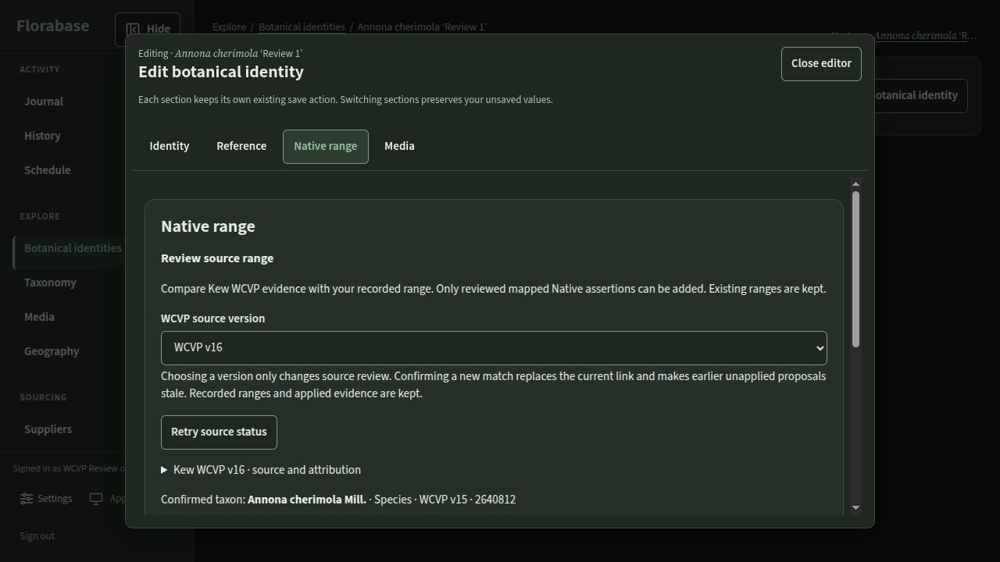

# Isolated WCVP Review

Open [WCVP Review](http://localhost:15281/#/identities). This environment contains **six synthetic
identities**, deliberately labelled with fictional `Review 1`…`Review 6` cultivars for scenario
separation. They are demonstration records, not botanical cultivar assertions or an operator collection.

Project `florabase-wcvp-version-001-review`, database/user `florabase_wcvp_review`, loopback port
15281, network `10.254.241.0/28` and all three named volumes belong only to this feature worktree.
Backend/database ports are not published. Source binds are live. Both independently built approved
production-format indices are installed under ignored `backend/src/.source-cache/wcvp-version-001/`.
No foreign Review, DEV, UAT, Preview, production, UI System v1 or research artifact was changed.

The private synthetic owner login/password file is
`/home/alessandro/.codex/worktrees/wcvp-version-001/florabase/.source-cache/florabase-wcvp-version-001-review/credentials.json` (0600). Read locally; do not publish it.
The adapter refuses to replace credentials for an existing owner if that file is lost.

```sh
python3 docs/review/wcvp-version-001/live-review.py status
python3 docs/review/wcvp-version-001/live-review.py check
```

The `up` action builds/starts only this exact project using existing ownership/migration guards.
`seed` initializes only an empty database, or validates and retains the existing scenario IDs.
There are no stop/remove/reset actions. Four host adapter tests and four live foreign-runtime/source
refusals cover the isolation boundaries. Repeat seed preserved all six identity/proposal IDs.

## Representative scenarios

From Botanical identities, select the scenario, **Open details → Edit botanical identity →
Native range → Check trusted source**. Reference text remains under the existing Reference section.
Every identity has a manually recorded Italy range and synthetic operator cultivation text.

| Scenario | Source | Exact ID | What to review |
| --- | --- | --- | --- |
| Annona cherimola ‘Review 1’ | v15 pending | 2640812 | Frozen v15 proposal with v16 installed; ADD Bolivia/Peru, keep Italy |
| Annona cherimola ‘Review 2’ | v15 applied | 2640812 | Immutable receipt, original v15 citation/crosswalk; Italy and applied ranges retained |
| Annona cherimola ‘Review 3’ | v16 pending | 2640812 | Select v16 explicitly; inspect its frozen v16 proposal and citation |
| Salvia warszewicziana ‘Review 4’ | v15 pending | 184159 | ID absent in v16; browsing/search does not migrate its retained v15 link |
| Hyptis coccinea ‘Review 5’ | v15 pending | 101680 | v16 synonym, accepted ID 101341; no automatic following or renaming |
| Homalomena mixta ‘Review 6’ | v16 pending | 100008 | v15 synonym pointing to 84907; v16 accepted/self; distinct explicit relationship |

## Operator acceptance checklist

- [ ] Opening the source panel starts on **v15** and performs no canonical range/profile write.
- [ ] In Review 1 choose **v16**: selected source is v16 while the confirmed link still says v15.
  “Retrieve source proposal” is withheld until a matching-version confirmation; selection alone
  must not mark the v15 link stale or create a v16 link.
- [ ] Expand Recent retained proposals and inspect the existing v15 proposal while v16 is selected.
  Its original source/hash/crosswalk and Italy CURRENT-ONLY are retained. Explicitly select Bolivia
  or Peru, inspect Add/Keep counts, then Confirm Apply. All existing ranges must remain.
- [ ] In Review 2 inspect applied history before and after choosing v16. Evidence still identifies
  v15; it cannot be applied twice or rewritten. Profile cultivation text remains unchanged.
- [ ] In Review 3 select v16, search the literal `Annona cherimola`, review exact ID2640812 and
  confirm separately. Earlier pending proposals must reject Apply as stale after reconfirmation.
  Retrieve a new v16 proposal and verify its distinct crosswalk and add/keep-only choices.
- [ ] In Review 4 search v16 for the original taxon: absence must not clear the v15 link or ranges.
- [ ] In Review 5 review v16 synonym context: it is not confirmable and does not follow accepted ID
  101341 automatically. In Review 6 compare the source statuses for ID100008 explicitly.
- [ ] Original distribution rows retain introduced/extinct/doubtful flags and unmapped units.
  No inferred country expansion, narrative import, range deletion or identity rename occurs.
- [ ] Confirm loading, retryable source errors, keyboard-labelled version selection, confirmation
  and success/conflict feedback are understandable. Operator acceptance is intentionally pending.

The four optional-index configurations, malformed/unknown releases, frozen Apply with absent index,
source failures and transaction conflicts are covered by the automated tests; do not remove or
reconfigure indices in another environment to repeat these checks.

## Verification evidence and limits

Focused backend **60 passed**; PostgreSQL **38 passed**; frontend **8 passed**; strict backend and
frontend typing passed. Review adapter **4 passed**, feature graph **117 valid**, whitespace passed.
The canonical final result is recorded by `make feature-verify` in this worktree's verification receipt;
consult that exact-tree receipt rather than treating the focused counts as a FULL result.

The real browser check confirmed default v15, explicit v16 selection with retained v15 link,
withheld cross-version proposal retrieval, frozen v15 history while browsing v16, Bolivia/Peru ADD
and disabled Italy CURRENT-ONLY. No domain write was made during browser inspection; the initial
synthetic v15 application was created by the guarded fixture. Operator Apply/reconfirmation remain
available for acceptance. The selected v16 source and preserved v15 link are visible together here:



Physical mobile/touch, assistive technology, real browser zoom, large-collection performance,
peak temporary disk usage and cgroup memory were not measured. The index resource observations
are [recorded separately](provisioning-v16.json); operational provisioning remains an explicit task.
No staging, commit, push, merge or release delivery has been started.
